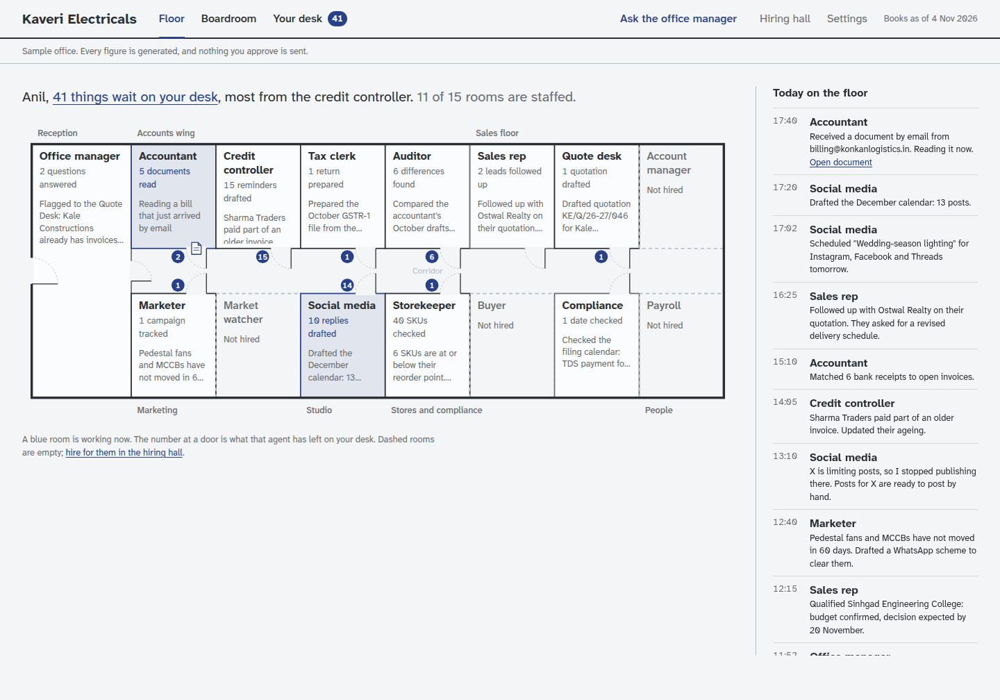
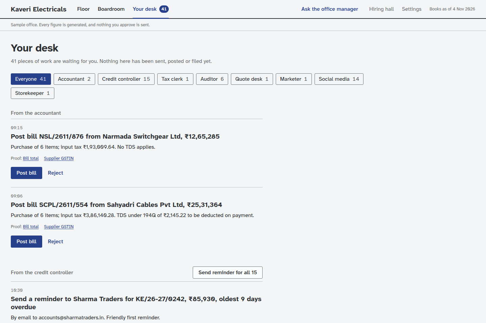

# Product requirements

> **In one paragraph.** The product is an office the owner walks into. *The Floor* shows the team at work, *The Boardroom* holds the reports with every figure traceable to its source, and *Your Desk* is where the owner approves or rejects what the team proposes. Agents are hired from the Hiring Hall and earn trust over time. People reach the office from a browser or from WhatsApp. One login can belong to several offices. Each requirement below is tagged **Core** (any market) or **India pack** (built for the first market), so it is clear what would change for another country.

## 1. Personas

Personas are written for any market. The Indian examples are illustrations.

| Persona | Who they are | What they need | Example |
| --- | --- | --- | --- |
| **The owner** | Runs a trading, manufacturing or services business with 5 to 100 staff. Not an accountant. Checks the business on a phone between other work. | To know the numbers are right, who owes what, and what is due, without reading ledgers. | Anil, owner of Kaveri Electricals, a Bengaluru electrical wholesaler |
| **The accountant** | An in-house accountant or an outside firm keeping the books and filing returns, often for many clients. | Clean source documents, fewer questions, files ready to upload, a clear list of differences. | Rajesh of Mehta and Associates, who looks after a dozen businesses |
| **The operator** | Our own team running the platform. | Offices that are isolated and cheap to run, plus tools to suspend, restore and support them. | The person with the admin tool |
| **The consultant or partner** | An adviser, reseller or accounting firm evaluating or extending the product. | A clear picture of what it does, what it costs and where it can go. | Readers of this handbook |

## 2. The three spaces

| Space | Purpose | Key behaviour |
| --- | --- | --- |
| **The Floor** | See the team at work | A line-drawn floor plan with a room per hired agent: what it is doing, today's count and a headline figure. Unhired rooms are drawn empty. A team log runs alongside. The only animation: an arriving document travels along the corridor to the room that handles it. |
| **The Boardroom** | Reports a business and its accountant already use | Sales by product and customer, ageing debtors in 0-30, 31-60, 61-90 and 90+ day buckets, tax registers, cash position, and a tab per team. An "as of" date picker. Every cell drills down to its documents. |
| **Your Desk** | Approvals | Each proposed change says exactly what will happen ("Send a reminder to Sharma Traders for INV-2231, ₹1,84,000, 34 days overdue") with Approve, Edit and Reject. |

## 3. The team

| Agent | Team | What it does | Status | Tag |
| --- | --- | --- | --- | --- |
| Office Manager | Front office | Answers questions in plain language with linked figures ("Who owes me the most, and since when?"); routes work between agents | Built | Core |
| Accountant | Accounts | Reads sales and purchase invoices arriving by email, upload or WhatsApp; extracts header, lines, product codes and tax; stages ledger entries linked to the document; sets aside duplicates | Built | Core, with India-pack fields (GSTIN, HSN) |
| Credit Controller | Accounts | Tracks due dates from payment terms, ages debtors, drafts reminders that escalate from polite to firm to final | Built | Core |
| Tax Clerk | Accounts | Computes tax deterministically and produces return files | Built | India pack (GST, TDS) |
| Auditor | Accounts | Imports what the accountant filed and explains each difference from the books in plain language | Built | Core method, India-pack returns |
| Social Media Manager | Social | Plans a monthly calendar, drafts posts per channel with every price and claim checked against the books, publishes after approval, listens for comments and messages and turns enquiries into leads | Built | Core |
| WhatsApp desk | Front office | Lists waiting approvals, takes "approve 1, 3" or "reject 2", answers questions, accepts voice notes, sends a daily digest | Built | Core, with Indian languages |
| Sales Rep, Quote Desk, Account Manager | Sales | Leads, tax-correct quotations from the price list, reorder predictions | Preview on the books | Core |
| Marketer, Market Watcher | Marketing | Promotes slow-moving products around the festival calendar, tracks competitor prices | Preview on the books | Core (calendar is per market) |
| Storekeeper, Buyer, Compliance Officer | Operations | Reorder points, vendor quote comparison, filing calendar | Preview on the books | Core, filing calendar per pack |
| Payroll Clerk | People | Payroll summary and payslip runs for approval | Preview on the books | Pack-specific statutory rules |

"Preview on the books" means the room, its reports and its approval cards work from the office's books, but the agent has no live outside data source yet.

## 4. Trust levels

| Level | Meaning | How an agent gets there |
| --- | --- | --- |
| Trainee | Every action waits for the owner's approval | Default on hire |
| Trusted | Routine actions run on their own; anything unusual waits | The owner promotes it, guided by its accuracy record |
| Autonomous | Acts on its own and reports what it did | The owner promotes it again |

Some work always waits regardless of trust: audit flags, file sharing, payroll runs, campaigns, social calendars, broadcasts and posts are reviewed on the Desk in full.

## 5. Offices, people and roles

- One login can belong to several offices, and anyone with a confirmed email address can open their own office (self-serve).
- Roles today: **owner** (everything, including approvals, hiring, people and deletion) and **accountant** (reads everything, downloads returns, answers the Auditor, cannot approve or hire).
- The owner invites people by email; the invitation link is single-use, expires after 14 days and only works for the invited address.
- Ownership can be handed over; an office always keeps at least one owner.
- Export: a zip of the books and every stored file. Delete: confirmed by typing the office name; restorable for 30 days, then purged.
- On WhatsApp, a person in several offices is asked which office a message is for, and can switch with a short command.

## 6. Functional requirements

Each requirement is written as a user story with acceptance criteria. **Tag** says whether it is Core or India pack.

| ID | Story | Acceptance criteria | Tag |
| --- | --- | --- | --- |
| F1 | As an owner, I open my office in a few minutes | Sign up, confirm email, name the business, land on an empty Floor with the Accounts team ready to hire | Core |
| F2 | As an owner, I send bills by email and they are read | Each office has its own inbound address; PDFs are stored, read and staged within a minute; a copy of an already-recorded bill is set aside | Core |
| F3 | As an owner, I see where any number came from | Every Boardroom figure opens the list of documents behind it, and each document opens with the relevant line highlighted | Core |
| F4 | As an owner, nothing changes without me | Staged changes appear on the Desk with an exact description; approving applies them; rejecting records why | Core |
| F5 | As an owner, I promote an agent when it has earned it | Trust level per agent in the Hiring Hall; Trusted agents run routine actions and log them | Core |
| F6 | As an owner, overdue customers get chased politely | Reminders drafted from due dates, escalating in tone, sent by email only after approval | Core |
| F7 | As an owner, my accountant's returns are checked | Import of filed returns; each difference explained with a reason and linked documents | Core method; India pack returns (GSTR-1, GSTR-3B, 26Q) |
| F8 | As an accountant, I download files ready to upload | GSTR-1 JSON, GSTR-3B and TDS summaries in Excel with formulas, not pasted values | India pack |
| F9 | As an owner, I approve from WhatsApp | A numbered list of waiting items; "approve 1 3", "reject 2"; items that need full review open on the Desk | Core |
| F10 | As an owner, I speak to the office in my language | Replies in the person's language; voice notes transcribed and repeated back before acting | Core mechanism; Indian languages today |
| F11 | As an owner, social posts never misstate a price | Every price and claim in a draft is checked against the books before it can be approved | Core |
| F12 | As an owner, I bring in my accountant | Invite by email, accountant role, revoke at any time; the accountant sees the role banner and cannot approve | Core |
| F13 | As a person in two offices, I never mix them up | An office switcher on the web; on WhatsApp, a heading or a choice whenever the office is ambiguous | Core |
| F14 | As an owner, I can leave with my data | Export everything as a zip; delete with 30 days to restore | Core |
| F15 | As an operator, I can support offices without reading their books | Admin tool lists offices, suspends and resumes, re-sends an owner invitation, backs up the control plane | Core |

## 7. Non-functional requirements

| Area | Requirement | Today | Tag |
| --- | --- | --- | --- |
| Isolation | No request can read or change another office's data; non-members get "not found" | Enforced at the Worker and again inside each office; covered by a two-office test suite | Core |
| Locale | Currency, digit grouping, date format and time zone come from the office, not the code | Fixed to rupees, Indian grouping and India time; seams identified in the architecture document | Core requirement, India values |
| Languages | Interface copy and WhatsApp replies in the person's language | WhatsApp in English, Hindi, Marathi, Gujarati, Tamil, Telugu, Kannada and Bengali; web interface in English | Core mechanism |
| Mobile | Every screen works at phone width | Yes, with phone screenshots for every screen | Core |
| Accessibility | Keyboard focus, reduced motion, AA contrast; a typeface that separates 0 from O and 1 from l | Atkinson Hyperlegible Next throughout | Core |
| Privacy | Export and deletion; purpose-limited processing; per-person removal on request | Built; data region per office designed, not built | Core, with law per pack |
| Fair use | Daily allowance per office | 400 AI calls and 250 MB of uploads per office per day | Core |
| Reliability | One office's failure does not affect others | One Durable Object per office | Core |
| Performance | Floor and Desk load in under two seconds on a mid-range phone | Static assets on the edge; live updates over a WebSocket | Core |
| Auditability | Who did what, when | Office history in Settings and the control-plane audit table | Core |

## 8. Settings

- **Business:** name and legal name, tax identifiers (PAN, GSTIN, TAN and state in the India pack), address, contact details, bank, start of the financial year.
- **Routine:** the time of the daily digest, and the reminder policy (days overdue before the first, firm and final reminder, and the sending address).
- **Office:** people and roles, invitations, the office's inbound email address, handover, history, export, delete.
- **Channels:** connect social accounts or post by hand; brand voice; posting hours.
- **WhatsApp:** link a phone, language, daily digest.
- **Look:** six office skins, saved per person.

## 9. What would change for another market

| Area | Core stays | Pack changes |
| --- | --- | --- |
| Accountant | Reading, staging, source links, duplicate detection | Field names and validation (VAT number, ABN, EIN) |
| Tax Clerk | The deterministic engine pattern and its tests | Rules, registers and return formats per country |
| Auditor | Compare filed with computed, explain in plain language | Which returns are imported and how they are parsed |
| Credit Controller | Ageing and reminder escalation | Wording norms; late-payment interest rules (for example the EU Late Payment Directive) |
| WhatsApp desk | Commands, lists, voice notes | Channel mix (SMS and email weigh more in the US), languages |
| Compliance Officer | Filing calendar mechanism | The calendar itself |
| Payroll Clerk | Payslip run approvals | Statutory deductions and filings (for example Single Touch Payroll in Australia) |
