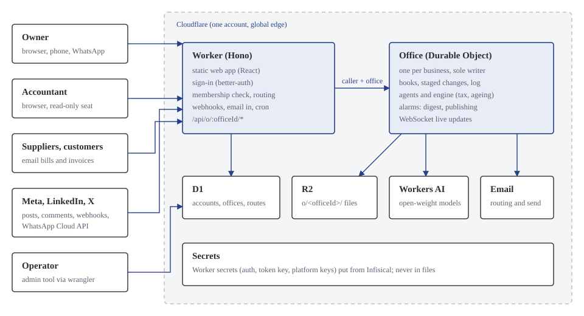
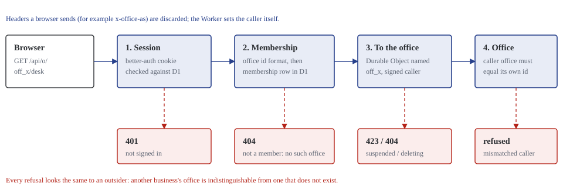
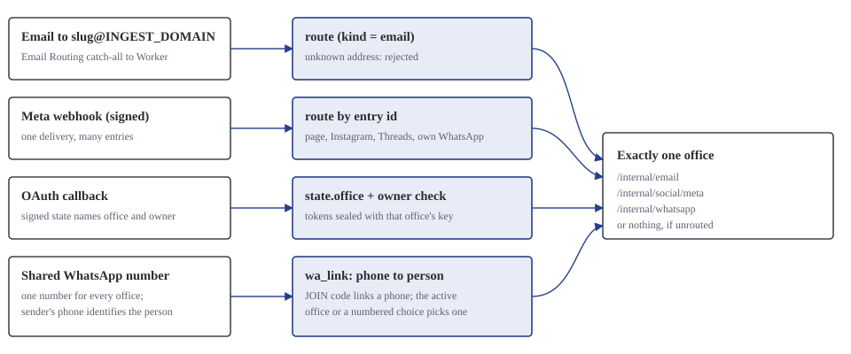
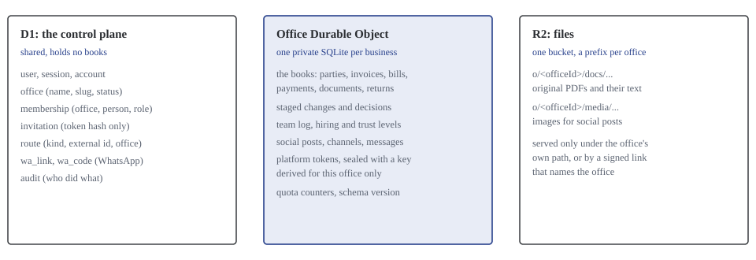

# Technical architecture

> **In one paragraph.** The Office is one Cloudflare Worker serving a React app and an API, plus one Durable Object per business that holds that business's books in its own private SQLite database and is their only writer. A small shared D1 database (the control plane) knows only who belongs to which office and where inbound mail and webhooks go. Files sit in R2 under a prefix per office. Documents are read with open-weight models on Workers AI, but every amount and every tax figure is computed by deterministic, unit-tested code. The same React app runs as a clickable demo with no backend at all, answering the real API routes from sample data inside the browser.

## 1. Codebase

A pnpm monorepo in TypeScript.

| Package | What it holds | Key libraries (licence) |
| --- | --- | --- |
| `apps/web` | The React app: Floor, Boardroom, Desk, rooms, Hiring Hall, Settings, office picker | React 19, Vite, TanStack Router, Query and Table (MIT), MSW for the demo (MIT), pdf.js for reading text layers in the browser (Apache-2.0) |
| `apps/api` | The Worker: routing, sign-in, the control plane, inbound email and webhooks, the `Office` Durable Object | Hono (MIT), Cloudflare Agents SDK (MIT), better-auth (MIT), Drizzle ORM (Apache-2.0) |
| `packages/contracts` | Every entity and API response as a zod schema, plus the route table | zod (MIT) |
| `packages/engine` | The books and the agents as pure TypeScript: ledger, GST, TDS, ageing, audit, reports, social, WhatsApp desk, Excel exports | ExcelJS (MIT) |
| `packages/fixtures` | The Kaveri Electricals sample business | |
| `packages/ui` | Shared components with Storybook stories: floor plan, ledger table, source viewer, approval card | Storybook (MIT) |
| `tools` | Synthetic data, screenshots, end-to-end checks, export verification, the admin tool | Python reportlab (BSD), Playwright (Apache-2.0) |

**One contract.** The web app, the demo's mock handlers, the Worker and the engine import the same zod types, so the demo cannot drift from the real product. Switching between them is a build flag (`VITE_DATA=mock` or `live`).

**Tests.** 266 engine tests (tax, ageing, audit, social, WhatsApp desk), 73 Worker tests (including a two-office isolation suite), Storybook stories for every component state, and a 26-check browser end-to-end run against a local Worker.

## 2. Runtime

| Piece | Role | Why this choice |
| --- | --- | --- |
| Worker (Hono) | Serves the app, signs people in, checks membership, routes each request to its office, receives email and webhooks, runs the nightly purge | Global edge, no servers, free tier |
| `Office` Durable Object | One per business. Holds the books in SQLite, runs the agents, schedules its own alarms (daily digest, social publishing), pushes live updates over a WebSocket | A single writer per business removes a whole class of concurrency and isolation problems |
| D1 | Control plane: accounts, sessions, offices, memberships, invitations, routes, WhatsApp links, audit | Small, shared, relational; holds no books |
| R2 | Original documents and social media images under `o/<officeId>/` | S3-compatible, no egress fees |
| Workers AI | Reading documents (Llama 3.3 70B for text layers, Llama 3.2 11B Vision for scans), Whisper for voice notes, translation for WhatsApp | Open-weight models, no API key, a free daily allowance |
| Email | Email Routing delivers inbound mail to the Worker; the `send_email` binding sends reminders, invitations and digests | No third-party mail service |

## 3. How a request finds its office

Every office API lives under `/api/o/:officeId/`. Account-level routes (`/api/me`, `/api/offices`, `/api/invitations/...`, `/api/auth/...`) do not.

1. **Session.** better-auth checks the session cookie against D1. No session: 401.
2. **Membership.** The office id must have the right format and the person must have a membership row. Anything else: 404, identical to an office that does not exist. Suspended offices answer 423; offices being deleted answer 404 except to their owner's restore and export.
3. **To the office.** The Worker forwards to the Durable Object named after the office id and sets the caller (person, role, office) itself. Headers from the browser that could claim a role are discarded.
4. **The office checks again.** The Durable Object knows its own id (stored on first start) and refuses any caller whose office does not match. Even a bug in the Worker could not hand one office's books to another.

The WebSocket for live updates follows the same path.

## 4. Inbound routing

Some traffic arrives without a signed-in person: email, platform webhooks, OAuth callbacks and WhatsApp messages. Each is resolved to exactly one office, or dropped.

| Channel | How the office is found |
| --- | --- |
| Email | Each office has `<slug>@INGEST_DOMAIN`. The `route` table maps the address to the office. Unknown addresses are rejected at the SMTP stage. |
| Meta webhooks (Facebook, Instagram, Threads, WhatsApp on an office's own number) | The signature is checked, then each entry is routed by its page or account id. One delivery can be split across several offices. |
| OAuth callbacks (connecting a social account) | The signed `state` names the office and the owner who started it; the callback checks both before storing tokens. |
| Shared WhatsApp number | One number serves every office. The sender's phone is linked to a person by a six-digit JOIN code issued in Settings. A person in several offices gets a heading on each message and can switch with a short command; ambiguous messages ask which office. |

## 5. Where data lives

- **The control plane (D1)** never holds books. It answers "who is this person, which offices are theirs, and where does this email or webhook go".
- **Each office's Durable Object** holds its books in its own SQLite database. There is no shared table of invoices with an `office_id` column to forget in a query.
- **Files (R2)** live under `o/<officeId>/docs/` and `o/<officeId>/media/`. They are served only through the office's own path, or through a signed media link (for the social platforms to fetch images) that names the office.

## 6. Security model

| Concern | Control |
| --- | --- |
| Sign-in | better-auth with email and password, email confirmation before opening an office or accepting an invitation, rate limiting on live |
| Tenant isolation | Membership check in the Worker; identity check in the Durable Object; per-office storage; per-office file prefix |
| Invitations | Single-use token, only its hash stored, bound to the invited address, expires after 14 days |
| Social and WhatsApp tokens | Encrypted at rest with a key derived per office (HKDF from `SOCIAL_TOKEN_KEY` and the office id), with a key version for rotation |
| Webhooks | Meta signatures verified with the app secret; the verify token checked on the handshake |
| Media links | HMAC-signed, expiring, scoped to one office |
| Fair use | Per-office daily allowance: 400 AI calls, 250 MB of uploads; a 429 with a plain explanation when spent |
| Secrets | Held in Infisical and put as Worker secrets; never in files or logs |
| Audit | Office events (invitations, role changes, handover, deletion, restore) in the `audit` table; agent work in each office's team log |
| Operator access | The admin tool works on the control plane only; it has no command to read an office's books |

## 7. Reading documents

1. **Text layer first, in the browser.** Uploaded PDFs are opened with pdf.js and their text layer is extracted on the person's device. This keeps CPU off the Worker.
2. **Model reads the text.** The Worker asks the text model to extract header, lines and tax into a strict JSON shape.
3. **Scans go to the vision model.** Documents without a text layer are rendered to an image and read by the vision model.
4. **Deterministic checks.** The engine recomputes every line and tax amount, checks the result against the stated totals, and detects duplicates.
5. **Staged, never posted.** The result becomes a staged change on the Desk with a link to the document and the highlighted region.

## 8. The engine

`packages/engine` is the heart of the product and has no dependency on Cloudflare. It runs identically in the Durable Object, in the browser demo and in tests.

- Money is integer paise with half-up rounding, mirrored exactly by the Python synthetic-data generator so test data and engine agree to the paisa.
- GST: place of supply, CGST and SGST versus IGST, HSN summary, GSTR-1 and GSTR-3B.
- TDS: sections 194C, 194J, 194Q (with the turnover threshold) and 194H; deposit due dates; 26Q.
- Ageing from invoice payment terms; reminder escalation.
- The Auditor's comparison of filed returns with computed figures, with reasons.
- The social calendar, drafting and price checks; the WhatsApp desk's command parser in eight languages.

## 9. The demo (mock mode)

The same production web app is built with `VITE_DATA=mock`. Mock Service Worker answers every real API route inside the browser from the sample books, running the real engine. The demo is used for sales conversations, design reviews and screenshots, and needs no backend.

## 10. Operations

- **Schema changes.** D1 uses numbered SQL migrations. Each Durable Object keeps a `schema_version` and runs its own steps once on start (for example, moving files to the per-office prefix).
- **Nightly job.** A cron at 21:30 UTC purges offices deleted more than 30 days ago (Durable Object storage, R2 prefix, control-plane rows).
- **Admin tool.** `tools/admin/admin.mjs`: list offices with activity, suspend and resume, send an owner invitation, add a route, purge a deleted office early, back up the control plane, remove a person on request.
- **Logs.** Every office log line is prefixed with the office id; Workers observability is on.

## 11. International readiness (design only)

Nothing in this section is built. It records where the code assumes India today, and where a market plug-in would go, so that expansion is an addition rather than a rewrite.

### 11.1 Already market-neutral

- Multi-tenancy, sign-in, roles, invitations, export and deletion.
- The source-linked books model, staged changes, the Desk, trust levels and the team log.
- The agent and room structure, the Floor, the Hiring Hall.
- The social channel interface (any platform behind one adapter).
- The WhatsApp desk's command model and the translation mechanism (fixed phrases per language, free text translated).

### 11.2 Where India is assumed today

A read-only audit of the codebase found these assumptions:

| Assumption | Where | Files affected (approx.) | Seam for another market |
| --- | --- | --- | --- |
| India time for "today", digest and cron times | `apps/api/src/time.ts` (`istDate`, `digestCron` fixed at UTC+5:30), several `Asia/Kolkata` formats | 10 | A time zone on the office record; `istDate` becomes `officeDate(office)` |
| Indian number and date formatting | `toLocaleString("en-IN")` across UI and engine copy | 20 | A locale on the office record, passed to one formatting module |
| Rupees and paise | `money.ts` (integer paise, Indian grouping), the ₹ sign in copy | 23 | A currency code on the office; integer minor units already generalise (cents, pence) |
| Indian tax identifiers in the business record | `Business` has `pan`, `gstin`, `tan`, `stateCode` | 19 for GSTIN | A `taxIds` map defined by the jurisdiction pack |
| GST and TDS rules, registers and returns | `gst.ts`, `tds.ts`, `excel.ts`, `audit.ts`, `imports.ts` | 18 for TDS | A jurisdiction pack interface: `taxLines`, `registers`, `returns`, `importFiled`, `filingCalendar` |
| Indian-language phrases and digit scripts | `whatsapp-phrases.ts`, digit normalisation in `whatsapp-desk.ts` | WhatsApp only | Add languages to the phrase table; the mechanism is generic |
| Indian phone formats | Country code 91 in WhatsApp handling and tests | 6 | E.164 throughout; validation per country |
| Festival calendar for the Marketer | Engine copy and fixtures | Few | A market calendar supplied by the pack |
| Sample data | `packages/fixtures`, `tools/synthetic` | All fixtures | One sample business per market for demos |

### 11.3 Seams to add when a market is entered

| Seam | What it would look like |
| --- | --- |
| Jurisdiction pack | A module per country implementing tax lines, registers, return files, filed-return import and the filing calendar. India's GST and TDS become the first pack. |
| Office locale | `country`, `currency`, `locale` and `timeZone` on the office record, chosen when the office is opened. |
| Channel adapters | The WhatsApp desk's logic behind a messaging interface, so SMS (for the US) or another channel can carry the same commands. |
| Accounting connectors | A `BusinessBackend` interface (planned since the first design) with readers for Tally (India), QuickBooks and Xero (US, UK, Australia), Sage and DATEV (EU). |
| E-invoicing | An outbound and inbound adapter for Peppol (EU, Australia, UK) and India's IRN, behind the same interface. |
| Data region | A region on the office record, mapped to Cloudflare's jurisdiction options (see the deployment document). |

### 11.4 Cheap habits to keep now

- No new hard-coded currency, locale or time zone: pass them in, even if the only value today is India's.
- Tax logic only inside the engine, never in the Worker or the UI.
- New business fields that are tax identifiers go into a structure that can hold other countries' identifiers.
- New copy avoids India-only idioms in core screens; India-specific wording lives with the India pack.

The existing [design plan](../design-plan.md) records the visual system: palette, type, the floor plan and the review rounds.
