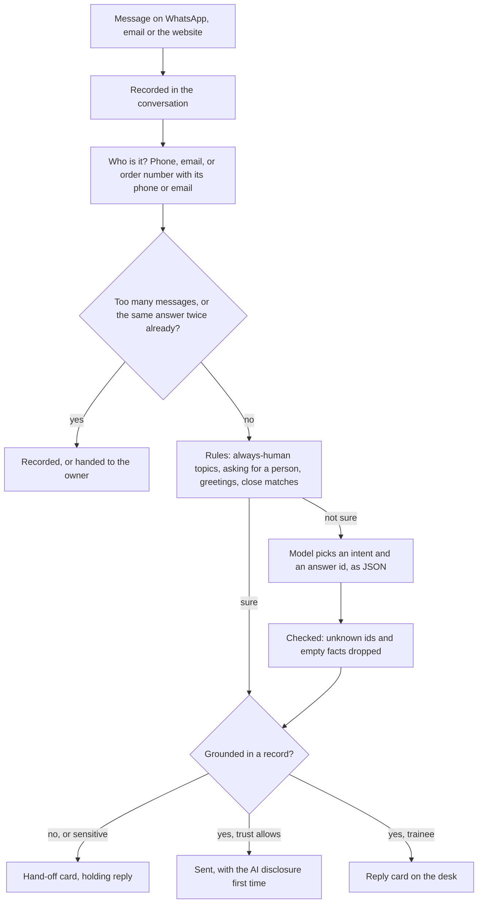

# The Customer Service agent

> **In one paragraph.** Owners we spoke to want one thing more than any other new agent: something that answers their customers on WhatsApp, email and their website, tells them where an order is or what they owe, sends the owner's usual answers to the usual questions, and passes everything else to the owner with the whole story so the customer never repeats themselves. Every competitor can chat; none of them knows the business's books. Ours does, so it can answer "how much do I owe you?" from the ledger and "where is SO-1042?" from the orders, and quote only figures it looked up. The first version is built: three channels, the owner's answers and business facts, orders that come from a list, a spreadsheet or a WhatsApp command, an identity check before any account detail is shared, a fixed list of topics that always go to a person, and the same trust levels as every other agent. The model only sorts messages; it never writes what a customer reads.

## 1. What the research says

### WhatsApp's rules

- **The AI-provider ban (from 15 January 2026).** Meta's WhatsApp Business Solution Terms ban general-purpose AI assistants on the Business Platform: a business may not offer "a chatbot" whose purpose is the AI itself. A business using AI to serve **its own customers about its own business** is explicitly allowed. So the agent must stay on topic. Anything unrelated to the business is handed to the owner, not answered.
- **A path to a person.** The Business Messaging Policy (updated 23 September 2026) allows automated replies inside the 24-hour customer service window only when there is a "prompt, clear, and direct" path to a human. Our first reply in every conversation says how to reach a person, and "PERSON" (or asking for one in any language we recognise) always reaches the owner.
- **No training on WhatsApp data.** Messages may not be used to train shared models. Workers AI runs inference only and keeps nothing, which the privacy notice says.
- **Templates outside the window.** More than 24 hours after the customer last wrote, only an approved template may be sent. The first version does not send templates to customers: the reply is held and the owner is told to call or use WhatsApp's own app.

### WhatsApp's prices (from 1 October 2026)

| Message | Price for an Indian business |
| --- | --- |
| Free-form reply inside the 24-hour window ("service") | Free for the first 1,000 a month per business number, then charged per message |
| Utility template (order update, payment reminder) | Charged per message, even inside the window |
| Marketing template | Charged per message, about ₹0.78 |

So the agent answers in one complete message rather than chatting in fragments, and its room shows the month's count against the 1,000 free.

### The EU AI Act, Article 50 (from 2 August 2026)

People must be told they are talking to an AI, at the latest at the first interaction, unless it is obvious. A line in the terms is not enough. We disclose everywhere, not only to customers in the EU: it costs one sentence and keeps us ready for the US, the EU and Australia.

### India's privacy law

- The **DPDP Rules 2025** bring the notice, consent and rights duties into force on **13 May 2027**. The notice must stand alone, be in plain language, list the data and what it is used for, and explain how to withdraw consent, use one's rights and complain to the Data Protection Board.
- Until then the **IT (SPDI) Rules 2011** apply: a published privacy policy and a grievance officer.
- Security logs must be kept for **one year**.
- For customer conversations the business is the data fiduciary and we act for it (a processor). Conversations are kept 12 months by default; the owner can choose 1 to 36.

### What good customer service software does (Intercom Fin, Zendesk, Gorgias)

1. **A small knowledge base, one answer per topic.** Long documents produce long, vague answers.
2. **Live lookups, never guesses.** "Where is my order" is answered from the order system or not at all.
3. **Topics that always go to a person:** refunds, complaints, legal threats, anger, price negotiation and cancellations.
4. **Hand-off with context.** The person who takes over sees the conversation, what the bot tried and why it stopped.
5. **Measure real resolution, not deflection.** A customer who gave up is not a resolved conversation.
6. **Guardrails in code, not only in the prompt.** A prompt can be talked around; a check in code cannot.

## 2. Who else does this

| Product | What it is | Price (indicative, late 2026) | What it lacks for our owners |
| --- | --- | --- | --- |
| Intercom Fin | AI agent over a help centre, very good hand-off | About $0.99 per resolution plus a seat | No books, no WhatsApp-first setup, priced in dollars |
| Zendesk AI agents | Ticketing with AI on top | Per seat plus per automated resolution | Built for support teams, not a shop owner |
| Gorgias | E-commerce helpdesk, Shopify-native | From about $10 a month, per ticket above | Shopify only; no GST invoices or ledger |
| Tidio (Lyro) | Website chat with an AI answerer | Free tier, then per conversation | Website first; WhatsApp is an add-on |
| WATI | WhatsApp Business API inbox and broadcasts, India | From about ₹2,500 a month plus Meta's charges | Flows are built by hand; no books |
| Interakt | WhatsApp commerce and catalogue, India | From about ₹2,700 a quarter plus Meta's charges | Marketing first; no accounts |
| AiSensy | WhatsApp broadcasts and chatbots, India | From about ₹1,000 a month plus Meta's charges | Broadcasts first; bots are decision trees |

**Our position.** The others answer from a help centre or a flow someone drew. Ours answers from the business's own books: invoices, payments and orders, scoped to the customer who is asking. It is one more agent in an office the owner already runs, with the same desk, trust levels and morning digest, not another inbox to watch.

## 3. What it does

**As the owner reads it in the Hiring hall:** "Answers your customers on WhatsApp, email and your website: order and invoice status, your usual answers, opening hours and policies. Anything it cannot answer from your records, or anything sensitive, it hands to you with a summary and a suggested reply."

| A customer asks | The agent | From |
| --- | --- | --- |
| "Where is my order SO-1042?" | Says its status, the expected date and the tracking link | The orders, only if the order is theirs |
| "How much do I owe you?" | Says how many invoices are open, the total and the oldest | Open invoices in the books, only for a known customer |
| "Will I get a GST invoice?" | Sends the owner's own answer, word for word | The owner's saved answers |
| "What time do you close?" | Sends the opening hours | The business facts (autonomous only) |
| "Hello" / "Thanks" | A short, polite reply | Nothing |
| "I want a refund" | Tells them the owner will reply, and when; puts a hand-off on the desk | Always the owner's |
| "Talk to a person" / "PERSON" | The same | Always the owner's |
| Anything else | The same | The owner's |

### How a message is answered

### Trust

| Level | What goes out on its own |
| --- | --- |
| Trainee | Nothing. Every reply is a card; a hand-off waits on the desk. |
| Trusted | Replies from a saved answer, an order or invoice lookup, the identity question, greetings and the holding reply on a hand-off. |
| Autonomous | Also replies from the business facts (hours, address, delivery, returns, payments). |

A hand-off is always the owner's, at every level (it is in `ALWAYS_ASK`).

### Identity, before any order or account detail

- **WhatsApp:** the number WhatsApp gives us is the customer's. It must match the phone on a customer in the books or on an order.
- **Email:** the sending address must match the customer or the order. (Email can be forged; it only ever unlocks order status and the open-invoice summary, never a change.)
- **Website:** an order number together with the phone or email on that order, in the same message or the last few.
- Until then the agent gives general answers only, and does not say whether an order number exists.

### Guardrails in code

- The model returns JSON with fixed choices. It never writes text a customer reads; every reply is the owner's own answer, a business fact, or a template filled from a lookup.
- Replies quote only figures returned by a lookup, for the verified customer.
- The always-human topics are matched by rules before the model is asked, and the model cannot overrule them.
- "PERSON" and asking for a person work in English, Hindi (both scripts), Marathi, Bengali, Tamil and Telugu.
- A loop guard: the same answer is not sent three times; the third time the owner gets it.
- A rate limit: more than eight messages in ten minutes in one conversation are recorded without a reply.
- The first message of every conversation says it is an AI and how to reach a person.
- Outside the business's hours, the holding reply says when the owner will answer.
- The website chat is rate limited per IP, can require Cloudflare Turnstile, and its key only finds this office's widget.

### The owner's side

- **Hand-off cards** show what the customer wrote, what the agent tried and why it stopped, who the customer is in the books, and a reply to finish. Sending it can also **save it as one of the owner's answers**, so next time the agent sends it.
- **On WhatsApp:** linked owners get each hand-off with a number and answer with `reply 3 your answer`. They can update an order with `order 1042 dispatched https://track…`.
- **The agent's room** holds the business facts, the saved answers, the orders (by hand or from a CSV), the website snippet, the support address, the conversations, and a box to try the agent as a customer would.
- **The room's figures:** waiting for you, answered without you over 30 days, average first reply, and WhatsApp replies this month against the 1,000 free.
- **The morning round** lists customers waiting more than four hours, WhatsApp chats about to close, and deletes conversations older than the retention period.

## 4. Channels and what they cost us

| Channel | How it arrives | How replies leave | Cost |
| --- | --- | --- | --- |
| WhatsApp, on the business's own number | Meta's webhook; when the agent is hired, customer messages go to it instead of the Social Media Manager's inbox | WhatsApp Cloud API, free-form inside 24 hours | Free for 1,000 a month, then Meta's per-message price |
| Email | The business forwards its support mail to `<slug>.help@INGEST_DOMAIN`; threads follow `In-Reply-To` | Cloudflare Email (`send_email`) until the Phase 6 provider | Nil on Cloudflare's allowance |
| Website chat | A small script (`/w/<key>.js`) on the business's site; posts to `/api/chat/<key>` and polls for replies | The same endpoint | Nil |
| Model calls | Workers AI, only when the rules are not sure | | A separate allowance of 150 a day per office, so a busy chat cannot use up the Accountant's reading |

## 5. How we will know it works

| Measure | Good | Where |
| --- | --- | --- |
| Answered without the owner | Over half within a month of setup | The agent's room |
| Hand-offs the owner answered without editing the suggestion | Rising week on week | Accuracy, as for every agent |
| First reply | Under a minute for answered messages | The agent's room |
| Hand-offs waiting more than four hours | None | Routines, the morning digest |
| Saved answers created from hand-offs | Several in the first month | The agent's room |
| WhatsApp replies in the month | Under 1,000 for a small business | The agent's room |

## 6. Phases

| Phase | What | State |
| --- | --- | --- |
| 6b, first version | Three channels; business facts and saved answers; orders by hand, CSV and WhatsApp; identity; always-human topics; trust; hand-off with save-as-answer; WhatsApp relay for owners; metrics; retention | Built |
| 9 | Shopify and WooCommerce order sources (through the `OrderSource` interface); Instagram and Facebook DMs; voice notes; a Vectorize knowledge base for longer answers; template sending outside the 24-hour window | Planned |
| Later | Order changes and refunds carried out by the agent, with approval; languages beyond the first six for the replies themselves | Ideas |

## 7. Not in this version

- Shopify and WooCommerce connectors.
- Instagram and Facebook DMs: they stay with the Social Media Manager.
- Voice notes from customers.
- Refunds or order changes made by the agent.
- A Vectorize knowledge base.
- Templates outside the 24-hour window.
- Live email sending, which waits on the Phase 6 email provider.
