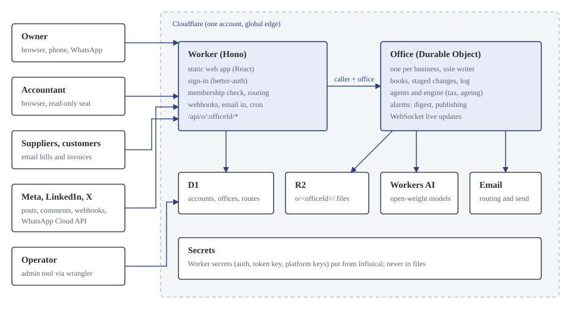
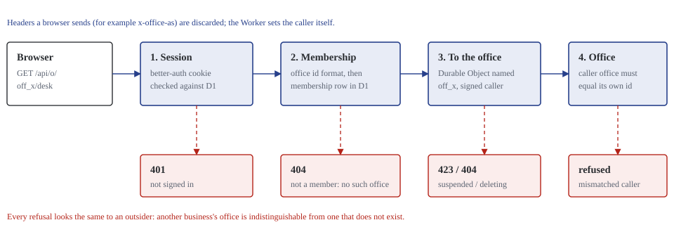
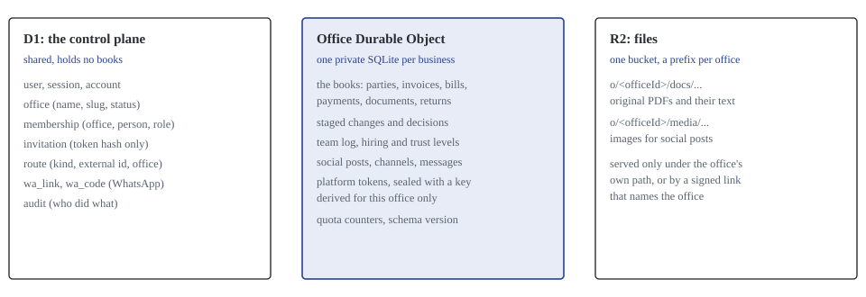
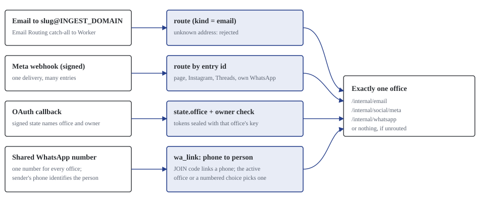
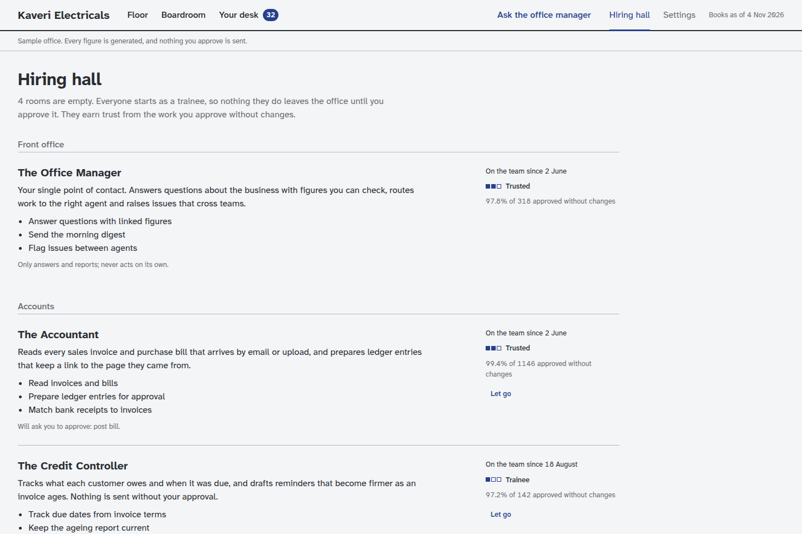

<!--
  The Agentic Office reference: one document for business, technical, user and support questions.
  Build the HTML page beside it with:  node tools/docs/reference.mjs   (writes docs/reference/index.html)
  Each "# " heading is a part of the document; "## " headings are its sections.
-->

# At a glance

> **In one paragraph.** Agentic Office by Snilld AI gives the owner of a small business a team of AI agents (an Accountant, a Credit Controller, a Tax Clerk, an Auditor, a Compliance Officer, a Social Media Manager and more) that work inside the business's own books. The team shows its work on an office floor plan, every figure can be opened down to the document it came from, and nothing changes until the owner approves it. India is the first market. The product runs on Cloudflare, with one private database per business, and reads documents with open-weight AI models while every amount and tax figure is calculated by tested code.

| | |
| --- | --- |
| Product name | Agentic Office by Snilld AI ("The Office" in code and older documents) |
| Who it is for | Owners of small and medium businesses, and the accountants who look after them |
| First market | India: GST, TDS, Companies Act filings, WhatsApp, Indian languages |
| Where it runs | Cloudflare (the Snilld account): one Worker, one Durable Object per business, D1, R2, Workers AI |
| The app | https://app.office.snilld.in |
| The demo | https://demo.office.snilld.in (a sample business, safe to show anyone) |
| Source code | `github.com/karthikwin-hub/the-office`, branch `main` |
| Secrets | Infisical, project for The Office, environment `dev` |

**How to use this document.** Each part stands on its own. Owners and their accountants want the **User guide**. People running the platform want the **Platform console**, the **Support manual** and **Domains and environments**. Partners and consultants start with **Business scenarios** and **Solution and architecture**. The detailed product and technical handbook (`docs/handbook`) and the go-live runbook (`docs/runbooks/phase-6-go-live.md`) go deeper; this document points to them where it summarises.

# Business scenarios

> **In one paragraph.** Each scenario below is something an owner, an accountant or our own team does with the product, from the trigger to the result. They describe the product as it is built today. "The owner approves" always means on the Desk in the app or by replying on WhatsApp.

## 1. The problem the product solves

A small-business owner signs off on figures they cannot verify. Sales, purchases, tax returns and overdue payments are prepared by a bookkeeper, an in-house accountant or an outside firm, and the owner sees a summary. When something is wrong (a bill posted twice, input tax claimed from a supplier who never filed, a customer 90 days overdue that nobody chased) the owner finds out late, from a notice, an auditor or the bank.

Owners do not want "automation". They want to see the truth and the proof, so they can hold their accountant, human or AI, to it. The product's three promises follow from that:

- **Every number has a source.** Any figure opens the bill or invoice behind it, with the line highlighted.
- **Nothing changes without the owner.** The team proposes; the owner approves, edits or rejects.
- **Trust is earned.** Each agent starts as a Trainee and can be promoted once its accuracy record shows it is reliable.

## 2. A supplier's bill arrives

| Step | What happens |
| --- | --- |
| Trigger | The owner forwards a supplier's bill to the office's own email address, uploads it in the Accountant's room, or sends a photo on WhatsApp. |
| The Accountant reads it | The bill's text is read, or a scan is read by a vision model. The supplier, GSTIN, lines, HSN or SAC codes and tax are extracted. |
| Checks | Tested code recomputes every line and the tax (CGST and SGST within the state, IGST between states), checks the totals and the GSTIN, flags TDS where it applies (for example section 194C on a courier bill over the limit) and sets aside a copy of a bill already recorded. |
| The owner decides | A card appears on Your Desk ("Post bill ₹36,475 from the courier, TDS 194C ₹618") with the document one click away. The owner approves, edits or rejects with a reason. |
| Result | The bill is in the books, linked to its document, counted in payables, GST and TDS reports, and visible in the Boardroom. |

Sales invoices are recorded the same way ("Record invoice"). Proforma invoices and delivery challans are recognised and filed without being posted. An invoice issued from the business's other GST registration is recognised as the business's own.

## 3. Customers who have not paid

The Credit Controller works out due dates from payment terms and ages every unpaid invoice into 0 to 30, 31 to 60, 61 to 90 and over 90 days. It drafts reminders that escalate from polite to firm to final, at the intervals the owner sets in Settings. Each reminder waits on the Desk; once approved it is emailed to the customer. The Boardroom shows who owes what and since when, and each figure opens the invoices behind it.

## 4. Monthly GST and TDS, and checking the accountant

1. The Tax Clerk calculates GST and TDS from the books with deterministic code, never with an AI model.
2. The accountant downloads files ready to upload: GSTR-1 in the offline tool's JSON format, and GSTR-3B and TDS summaries in Excel with live formulas.
3. After filing, the accountant's filed returns are imported, and the Auditor explains every difference from the books in plain language, with the documents linked.
4. The product prepares and reminds; the owner or the CA files on the government portals. No agent logs in to a government portal or signs with a DSC.

## 5. The company's statutory calendar

The Compliance Officer builds the company's own filing calendar from a short profile (most of it filled from the books): GST returns, TDS deposits and returns (including the change to the Income-tax Act 2025 for payments from 1 April 2026), advance tax, the income-tax return and audit, MCA forms (AOC-4, MGT-7, DIR-3 KYC, DPT-3, MSME-1 and others), PF, ESI and professional tax. Each item says why it applies, when it is due, what is at stake if missed, and who is doing it. Reminders go out 7 days and 2 days before, on the day, and weekly while late. Checks on the books, such as micro and small suppliers owed beyond 45 days, propose actions on the Desk.

## 6. Bringing in the books a business already keeps

A business moving from Tally or spreadsheets fills in three CSV templates in Settings, under **Bring in your books**: customers and suppliers, products and stock, and unpaid invoices and bills. The check reads every row and says exactly what to fix, by row number: a GSTIN whose check digit is wrong is refused with a hint, for example that a letter I was typed for the digit 1. When everything reads correctly, one card goes to the Desk; the owner approves it all at once. The first approved import fixes the date the books start from.

## 7. Approving from WhatsApp, in the owner's language

An owner who links their phone in Settings gets a daily digest and can approve from WhatsApp: "approve 1 3", "reject 2". They can ask questions in English, Hindi, Marathi, Gujarati, Tamil, Telugu, Kannada or Bengali, by text or voice note; a voice note is repeated back before anything is done. Items that need a full review, such as posts and payroll runs, open on the Desk instead.

## 8. The business's own customers ask questions

The Customer Service agent answers the business's customers on the business's WhatsApp number, by email and in a chat on the business's website. It answers order status and account balance from the books (after the customer is identified) and business facts from answers the owner has saved. It hands refunds, complaints and anything it cannot ground to the owner, with a short summary, and never leaves a customer without a reply. The AI only classifies messages; the words come from the books, the facts or a saved answer.

## 9. Social media that never misstates a price

The Social Media Manager plans a monthly calendar, drafts posts for Instagram, Facebook, Threads, LinkedIn, X and WhatsApp broadcast, checks every price and claim against the books, and publishes only after approval. It listens for comments and messages and turns enquiries into leads. Without a platform connection it prepares a publishing pack and the owner posts by hand.

## 10. An accountant who looks after several businesses

One login can belong to several offices. An owner invites their accountant by email; the accountant reads everything, downloads returns and answers the Auditor, but cannot approve or hire. The accountant switches between clients with the office menu at the top left.

## 11. Opening a new client's office (our team)

A platform owner opens the platform console, enters the business's name and the owner's email address, and presses **Open the office and invite**. The owner receives a 14-day, single-use invitation by email, makes an account with that address, and lands in an empty office ready to hire the Accounts team. Further owners and the accountant are invited from the office's own Settings.

## 12. Showing the product

The demo at https://demo.office.snilld.in runs the real app with a sample business, Kaveri Electricals, entirely in the visitor's browser. It opens on the Lived-in office: the office as a 3D pop-up book, with the team at work. Nothing in the demo is saved on a server, so it is safe to hand to anyone.

# Solution and architecture

> **In one paragraph.** The product is one Cloudflare Worker that serves the React app and the API, plus one Durable Object per business that holds that business's books in its own private SQLite database and is their only writer. A small shared database (D1, the control plane) knows only who belongs to which office and where inbound email and webhooks go. Files sit in R2 under a folder per office. Documents are read with open-weight models on Workers AI; every amount and tax figure is computed by deterministic, unit-tested code. The same app runs as the demo with no backend, answering every API route from sample data in the browser.



## 1. The product in three spaces

| Space | What it is for |
| --- | --- |
| **The Floor** | The team at work: a room per hired agent with what it is doing, today's count and its headline figure, and a team log alongside. In the Lived-in look the office is a 3D pop-up book (see section 8). |
| **The Boardroom** | Reports a business and its accountant already use: sales, ageing, tax registers, cash, and a tab per team. Every figure drills down to its documents. |
| **Your Desk** | Approvals. Each card says exactly what will happen, with Approve, Edit and Reject. |

## 2. The team

| Agent | Team | What it does | Depth today |
| --- | --- | --- | --- |
| Office Manager | Front office | Answers questions in plain language with linked figures; the front door of the office | Built |
| Customer Service | Front office | Answers the business's own customers on WhatsApp, email and website chat | First version built |
| Accountant | Accounts | Reads bills and invoices; stages entries linked to their documents; sets aside duplicates | Built |
| Credit Controller | Accounts | Ages debtors; drafts escalating reminders | Built |
| Tax Clerk | Accounts | GST and TDS by deterministic code; return files | Built (India) |
| Auditor | Accounts | Compares filed returns with the books and explains differences | Built |
| Compliance Officer | Operations | The company's filing calendar, checks on the books, MCA filing packs | Built (India) |
| Social Media Manager | Social | Calendar, drafts, price checks, publishing after approval | Built |
| Sales Rep, Quote Desk, Account Manager | Sales | Leads, quotations, reorder predictions | Preview on the books |
| Marketer, Market Watcher | Marketing | Festival promotions, competitor prices | Preview on the books |
| Storekeeper, Buyer | Operations | Reorder points, vendor quotes | Preview on the books |
| Payroll Clerk | People | Payroll summary and payslip runs for approval | Preview on the books |

"Preview on the books" means the room, its reports and its approval cards work from the office's books, but the agent has no live outside data source yet.

**Trust levels.** Every agent starts as a **Trainee** (everything waits for approval), can be promoted to **Trusted** (routine work runs on its own and is logged) and then **Autonomous**. Audit flags, file sharing, payroll runs, campaigns, calendars, broadcasts and posts are always reviewed on the Desk whatever the level.

## 3. Components

| Package | What it holds |
| --- | --- |
| `apps/web` | The React app (Floor, Boardroom, Desk, rooms, Hiring hall, Routines, Settings, office picker, sign-in, platform console). React 19, Vite, TanStack Router and Query. Built twice: live, and the demo with `VITE_DATA=mock`. |
| `apps/api` | The Cloudflare Worker: routing, sign-in (better-auth), the control plane, inbound email and webhooks, the `Office` Durable Object, the weather lookup. Hono, Drizzle. |
| `packages/contracts` | Every entity and API response as a zod schema, and the route table. The app, the demo, the Worker and the engine all use the same types. |
| `packages/engine` | The books and the agents as pure TypeScript: ledger, GST, TDS, ageing, audit, compliance, reports, social, WhatsApp desk, imports, Excel exports. No Cloudflare dependency. |
| `packages/ui` | Shared components: the floor plan, the 3D Lived-in office, the ledger table, the source viewer, approval cards. |
| `packages/fixtures` | The Kaveri Electricals sample business. |
| `tools` | The admin tool, deploy script, end-to-end checks, screenshots, this document's builder. |

## 4. How a request finds its office

Every office API lives under `/api/o/<officeId>/`. Account routes (`/api/me`, `/api/offices`, `/api/invitations/...`, `/api/auth/...`) do not.



1. **Session.** The session cookie is checked against D1. No session: 401.
2. **Membership.** The person must be a member of the office. Anything else answers 404, exactly as an office that does not exist. A suspended office answers 423.
3. **To the office.** The Worker forwards to the Durable Object named after the office id, and sets the caller (person, role, office) itself; headers from the browser that claim a role are discarded.
4. **The office checks again.** The Durable Object knows its own id and refuses any caller for another office. Even a bug in the Worker could not hand one office's books to another.

## 5. Where data lives



| Store | Holds | Never holds |
| --- | --- | --- |
| D1 `office` (control plane) | Accounts, sessions, offices, memberships, invitations (only a hash of each link), routes for inbound mail and webhooks, WhatsApp links, consent records, audit | Any business's books |
| One Durable Object per office (SQLite) | That office's books, staged changes, team log, routines history, customer conversations, the field-level edit log, persona names | Another office's data |
| R2 `office-docs` | Original documents and images under `o/<officeId>/`; books kept eight years after deletion under `retained/<officeId>/` | Files outside the office's folder |

## 6. Inbound traffic



| Channel | How the office is found |
| --- | --- |
| Bills by email | Each office has `<slug>@in.office.snilld.in`. The `route` table maps the address to the office; unknown addresses are refused. At most 5 attachments per email, PDFs and images. |
| Customer service email | `<slug>.help@in.office.snilld.in`, claimed when the Customer Service agent is hired. |
| WhatsApp (shared number) | One number serves every office. A person's phone is linked with a six-digit code from Settings; someone in several offices is asked which office a message is for. |
| WhatsApp (a business's own number), Facebook, Instagram, Threads | Webhook signatures are checked, then each message is routed by its page, account or number id. |
| Website chat | `/api/chat/<key>`, rate-limited per visitor, no cookies; answers 404 when the chat is off. |

## 7. Reading documents, and keeping AI away from the figures

1. **Text first, in the browser.** A PDF's text layer is extracted on the person's own device with pdf.js.
2. **A model reads the text** into a strict JSON shape (Llama 3.3 70B on Workers AI). Scans go to a vision model (Llama 3.2 11B Vision). Voice notes go to Whisper.
3. **Tested code checks it.** The engine recomputes every line and tax amount, checks the totals and the GSTIN, and looks for duplicates.
4. **Staged, never posted.** The result becomes a card on the Desk linked to the document and its highlighted region.

Money is held in integer paise. Tax is never decided by a model.

## 8. The Lived-in office (3D)

The Lived-in look turns the Floor into a papercraft pop-up book. It is a picture only: it reads the same office view as the plain Floor and changes nothing any agent does.

- **What it shows.** A red bahi-khata opens on a desk and the office folds up out of the page. The painted sky behind follows the real sun and moon over the business's city (from the weather lookup's approximate location, else the capital of its GST state). Lamps come on at dusk. The team walks the office: a paper plane brings an email to reception, sheets are carried to the pile on the owner's desk, approvals are stamped with the seal and filed, rejections are crumpled into the bin, and a new hire's room folds up out of the page.
- **Which rooms.** Only the staffed rooms, with the vacancies in one flat corner, unless the person chose **Show the whole floor**, in which case every room is drawn and the empty ones lie flat.
- **How it is built.** three.js in its own download, loaded only for this look. Shaders are compiled before the book opens; it draws at 30 frames a second when little is moving, every frame during the opening and camera moves, and nothing while the tab is hidden. Plates and speech bubbles are ordinary HTML links and text on top of the picture.
- **When it steps aside.** Phones and small tablets get the plain floor in the look worn before Lived-in, with the team's names on the doors. Without WebGL 2, with data saver on, on a low-memory device, on a device that cannot keep up in the first seconds, or when the person ticks **Use the simpler picture** in Settings, the drawn 2D Lived-in floor is shown instead.

## 9. Security model

| Concern | Control |
| --- | --- |
| Sign-in | Email and password (better-auth), email confirmation before opening an office or accepting an invitation, rate limiting |
| Isolation between businesses | Membership check in the Worker, identity check in the Durable Object, a database per office, a file folder per office |
| Invitations | Single use, bound to the invited address, 14 days, only a hash stored |
| Password reset | A link by email that works once, for an hour; other sessions are signed out |
| Platform tokens | Encrypted per office with a key derived from `SOCIAL_TOKEN_KEY` |
| Operators | The platform console and admin tool see the control plane only; there is no command to read a business's books |
| Edit log | Every change to the books recorded (old and new value, who, when), hash-chained, refused by the database if anyone tries to alter it, kept eight years |
| Secrets | Infisical and Cloudflare's secret store; never in files, chat or logs |
| Fair use | Per office per day: 400 AI calls (150 of them for customer service) and 250 MB of uploads; a plain 429 when spent |

## 10. The demo build

The same app built with `VITE_DATA=mock` answers every real API route inside the browser (Mock Service Worker) from the sample books, running the real engine. Changes a visitor makes are kept in that browser only. It is deployed as its own Worker, `the-office-mock`, serving only static files.

## 11. Quality

The engine has 384 automated tests (tax, ageing, audit, compliance, imports, social, WhatsApp, the 3D office's sky, routes and paper trail) and the Worker 118 (including a two-office isolation suite). `tools/e2e/live.mjs` drives a browser through the live product end to end.

# Domains and environments

> **In one paragraph.** Everything the public sees is under `office.snilld.in`, in the Snilld Cloudflare account. Three addresses are websites people use (the product page, the app and the console), one is the demo, and one is not a website at all but the email domain bills are sent to. An older copy in a separate Cloudflare account is no longer used and is due to be deleted.

## 1. Addresses

| Address | What it is | Who uses it |
| --- | --- | --- |
| **office.snilld.in** | The product page: the marketing site | Prospective customers |
| **app.office.snilld.in** | The app: sign in, choose an office, work in it. Invitation, confirmation and password-reset links point here; social sign-in callbacks return here | Business owners, their accountants, and our team |
| **console.office.snilld.in** | The platform console: every business's account, onboarding, invitations, suspending. Shows accounts, never books | Platform owners only (see Configuration) |
| **demo.office.snilld.in** | The public demo with the sample business Kaveri Electricals; nothing is saved on a server | Sales demonstrations, reviews |
| **in.office.snilld.in** | Not a website: the email domain for incoming mail. Each office receives bills at `<slug>@in.office.snilld.in` and customer email at `<slug>.help@in.office.snilld.in` | Businesses forward bills there |
| **`<name>`.office.snilld.in** | Optional: an office's own web address, for example `neltrade.office.snilld.in`. None are set up yet; each is added on request with `admin.mjs subdomain` | One business each |
| **support@snilldai.com** | Not a website: the sender of invitations, confirmations, password resets, reminders and digests, sent through Resend | Outgoing email |
| **the-office.the-office-agents.workers.dev** | The old Cloudflare account's copy, from before the move. Holds only test data; not used | Nobody. Delete with the runbook, Part 5 step 9 |

One sign-in covers every address under `office.snilld.in`: the session cookie is set for the whole domain.

## 2. Environments

| Environment | Where | Data | Deployed by |
| --- | --- | --- | --- |
| Live | The Worker `the-office` in the Snilld Cloudflare account, on the addresses above | Real offices: D1 `office`, R2 `office-docs`, one Durable Object per office | `infisical run --env=dev --silent -- sh tools/admin/deploy.sh` |
| Demo | The Worker `the-office-mock` on demo.office.snilld.in | Sample books in the visitor's browser | `infisical run --env=dev --silent -- sh tools/admin/deploy.sh demo` |
| Local | `wrangler dev` and Vite on a developer's machine (`pnpm dev` for the mock app) | Local state only | Not deployed |
| Old account | "the-office-agents" Cloudflare account | Test data only | Not deployed; to be deleted |

## 3. Outside services

| Service | Used for | Notes |
| --- | --- | --- |
| Cloudflare (Snilld account) | Hosting, database, files, AI models, DNS for `snilld.in`, email routing | The deploy token is `CLOUDFLARE_API_TOKEN_SNILLD_OFFICE` in Infisical |
| Resend | Sending email from `support@snilldai.com` | `snilldai.com` is verified there (shared with Clubs and Sports OS) |
| MET Norway (api.met.no) | The weather near the viewer, for the Lived-in office | Only a location rounded to about ten kilometres is sent; data under CC BY 4.0, credited in the app |
| Meta, LinkedIn, X | Social posting, comments and messages; WhatsApp | Optional per platform; without keys a channel works by hand |
| GitHub | Source code | `karthikwin-hub/the-office` |
| Infisical | Secrets | Project for The Office, environment `dev` |

# User guide

> **In one paragraph.** This part is for the owner of a business and their accountant. It walks through getting into the office, finding your way round, approving the team's work, sending documents in, bringing in existing books, hiring and promoting agents, inviting people, and choosing how the office looks. Everything works on a phone as well as a computer.


## 1. Getting in

**First time, from an invitation.** Open the link in the invitation email. Make an account with the address the invitation was sent to (your name, that email address and a password of at least 10 characters), accept the terms, and confirm your address from the email you receive. You land in the office.

**Every time after that.** Go to https://app.office.snilld.in and choose **Sign in**. Invitation links work once: after you have joined, use the app's address, not the old link. An old link now opens on Sign in and says it has been used.

**Forgotten password.** On the sign-in page choose **Forgotten your password?**, enter your email address, and open the link we send. It works once, for an hour. After you choose a new password you are signed out everywhere else.

**More than one office.** If you belong to several, choose one after signing in. Switch at any time with the office name at the top left, which also offers **Open another office**.

## 2. Finding your way round

| At the top | What it opens |
| --- | --- |
| The office name | Switch office, or open another |
| **Floor** | The team at work, and today's team log |
| **Boardroom** | Reports, every figure traceable to its documents |
| **Your desk** (with a count) | Everything waiting for your decision |
| **Ask the office manager** | Questions in plain language, answered with linked figures |
| **Hiring hall** | Hire agents and set how far you trust each one |
| **Routines** | What the office does on a schedule, and when it last ran |
| **Settings** | Your business, people, channels, look and account |

## 3. The Floor

Each hired agent has a room showing what it is doing now, how much it has done today, and one figure worth your attention, such as the value of bills waiting. A number at a room's door is what that agent has left on your desk. The team log beside the floor lists today's work, newest first.

**On a computer, a click opens the agent beside the floor.** Click a room, its name plate or the agent in the picture, and the panel on the right shows what the agent is doing, its figures, what is waiting for you (approve or reject right there) and what it did today, without leaving the floor. In the Lived-in office the view glides to that room. **Open the full room** goes to the agent's own page; **×**, **Back to today on the floor** or the Esc key closes the panel. Clicking **Your desk** shows everything waiting for you in the same panel. Hold Ctrl (Cmd on a Mac) while clicking to open the full room in a new tab instead. On a phone or a narrow window, a click opens the room's own page.

Under the floor, **Show the whole floor** also draws the rooms you have not hired for, and **Skin** changes the look (see section 10).

## 4. Your Desk: approving work


Each card says exactly what will happen if you approve it, with the documents one click away.

- **Approve** applies it: posts the bill, sends the reminder, files the challan.
- **Edit** lets you change the words before approving (for example a reminder's message).
- **Reject** asks why; the agent learns from your reason.
- When several cards do the same thing, **Approve all** appears above them.

Nothing reaches a customer, a supplier or a social channel until it is approved, by you or by an agent you have trusted with that routine work.

## 5. The Boardroom


Reports by team: Accounts (sales, purchases, ageing, GST, TDS, cash), Sales, Marketing, Social, Operations and People. Choose the **as of** date at the top. Click any figure to see the documents behind it, and any document to open it with the line highlighted. Excel downloads keep their formulas, so your accountant can check them.

## 6. Sending documents in

| Way | How |
| --- | --- |
| Email | Forward bills and invoices to your office's own address, shown in **Settings → Office** (it ends `@in.office.snilld.in`). Up to 5 PDF or image attachments per email. |
| Upload | In the Accountant's room, choose or drop files. |
| WhatsApp | Once your phone is linked (section 9), send a photo or PDF. |

The Accountant reads each document and puts a card on your desk. A copy of a bill already recorded is set aside, and the room says so. Proformas and delivery challans are filed, not posted.

## 7. Bringing in your existing books

In **Settings → Bring in your books**, download the three templates (customers and suppliers; products and stock; unpaid invoices and bills), fill them in from Tally or your spreadsheets, and upload them. **Check the files** reads every row and lists anything to fix, with the row number. When everything reads correctly, send them to your desk and approve the one card. The first approved import sets the date your books start from; it cannot be changed afterwards.

## 8. Hiring and trusting agents



In the **Hiring hall**, hire an agent to give it a room and set it to work. Each agent starts as a **Trainee**: everything it proposes waits for you. Its accuracy record shows how often its proposals were right. When you are comfortable, promote it to **Trusted** (routine work goes ahead and is logged) and later **Autonomous**. You can demote or let an agent go at any time.

## 9. People, WhatsApp and the accountant

- **Invite people** in **Settings → Office**: enter their email address and choose **Owner** (everything, including approvals and hiring) or **Accountant** (reads everything and downloads returns, but cannot approve or hire). The invitation works once, for 14 days, and only for that address. You can withdraw a pending invitation, and hand ownership to someone else; an office always keeps at least one owner.
- **WhatsApp** in **Settings → WhatsApp**: link your phone with the six-digit code, choose your language and whether you want the morning digest. Then reply "approve 1 3" or "reject 2" to the list you receive, or ask a question by text or voice.
- **Your accountant** sees a banner showing their role. The Compliance Officer opens on the CA view for them: the filings as a working table, the papers to download, and the trail of every change.

## 10. How the office looks

Choose a look in **Settings → Your office** or with **Skin** under the floor. It is personal: only you see it, on any computer you sign in on.

- **Blueprint, Open plan, Cubicles, Counting house, Loft, Night shift**: the floor as an architect's plan, in different styles.
- **Lived-in**: the office as a 3D pop-up book, lit by the sun where you are, with the team named and at work. You can rename the team for your office in Settings. On a phone it shows the plain floor with the names on the doors. If it is slow on your computer, tick **Use the simpler picture**. Add `?at=18:30` to the address to see the office at that time of day, for a demonstration.

## 11. Your own account and your data

In **Settings → Your account** you can download a copy of your account data or ask for your account to be deleted. An owner can export the whole office as a zip (books and every file) and delete it in **Settings → Office**; a deleted office can be restored for 30 days.

# Platform console

> **In one paragraph.** The console at https://console.office.snilld.in is for the people who run the platform. It lists every business on the platform and lets a platform owner open an office for a new business, send or re-send the owner's invitation, and suspend or reopen an office. It shows accounts, not books: no office's books, files or conversations can be seen or reached from it.

## 1. Who can use it

Only the addresses in `PLATFORM_OWNERS` (today puja@snilldai.com and appforge.3b@gmail.com), signed in with a confirmed address. Anyone else is refused. To add someone, add their address to `PLATFORM_OWNERS` in `apps/api/wrangler.jsonc` and deploy.

## 2. What it shows

For each business: name, owners, how many people, status (active, suspended, deleting), when and how it was opened (signed up, or onboarded by whom), its email-in address and web address, any pending owner invitation, and the date of its last account change.

## 3. Opening an office for a new business

1. Enter the business name and the owner's email address.
2. Press **Open the office and invite**. An empty office is created and the owner is emailed a 14-day invitation from `support@snilldai.com`. The link is also shown on screen with **Copy the link**, in case the email goes astray.
3. The owner makes an account with that address and lands in the office. Add more owners or the accountant from the office's own **Settings → Office**, or a second owner from the console.

## 4. Other actions

- **Send the invitation again** when an owner has not received it or it has expired.
- **Suspend** closes an office to its people (they see that it is suspended); **Open** reopens it.
- Every console action is written to that office's audit trail under the platform owner's address.

# Support manual

> **In one paragraph.** This part is for whoever answers support questions and keeps the platform running. It starts with how to tell what is wrong, lists the questions people actually ask with their fixes, then gives the procedures: the admin tool, read-only database queries, deploying and rolling back, backups, monitoring and security incidents. Every command that needs a Cloudflare token runs through Infisical; nothing is put in a file.

## 1. First steps for any problem

1. **Is the site up?** Open https://app.office.snilld.in. The sign-in page should load.
2. **Is sign-in working?** Signing in with a made-up address should say "Invalid email or password". Any other error points at the Worker or the database.
3. **Is it one person or everyone?** One person: their account, membership or invitation (sections 2 and 4). Everyone: the latest deploy (section 6) or Cloudflare's status page.
4. **Is the data there?** Read the control plane (section 5). It shows every office, person, membership and invitation.
5. **Write down** what was found and done (section 9).

## 2. Common questions

| What the person says | Likely cause | What to do |
| --- | --- | --- |
| "The invitation link does not work" | Invitation links work once and for 14 days. A used or expired link opens on Sign in with a note | If they have joined, they sign in at the app. If not, the owner sends a new invitation from **Settings → Office**, or a platform owner re-sends from the console |
| "It says the account already exists" | They tried to make a second account with an address that has one | Choose **Sign in**; the page switches there itself and keeps what was typed |
| "I forgot my password" | | **Forgotten your password?** on the sign-in page; the link works once, for an hour |
| "No email arrived" (invitation, confirmation, reset) | Spam folder; mistyped address; sending not set up | Check spam for `support@snilldai.com`. Check the address in the console. Check `RESEND_API_KEY` is on the Worker |
| "I cannot see my office" | Not a member, or suspended | Read memberships (section 5). Suspended offices are reopened from the console |
| "This invitation is for another address" | Signed in with a different email from the one invited | Sign out and sign in with the invited address, or the owner invites the address they use |
| "I emailed a bill and nothing happened" | Wrong address; more than 5 attachments; not a PDF or image; it was a duplicate | Use the address in **Settings → Office**. Emailed documents are read when someone in the office next has the app open |
| "It says the daily allowance is used" | 400 AI calls or 250 MB of uploads in a day for the office | It resets the next day; upload text PDFs rather than scans where possible |
| "My import is refused" | A row needs fixing | The check names the row and column, for example a GSTIN whose check digit is wrong; fix and check again |
| "The 3D office is slow or blank" | Older computer or graphics, data saver, or WebGL off | Tick **Use the simpler picture** in Settings; phones always get the plain floor |
| "Empty rooms show on the floor" | **Show the whole floor** is on | Choose **Show only staffed rooms** under the floor |
| "The weather is missing" | The weather lookup failed or the location is unknown | Nothing to fix; the sun uses the GST state's capital instead |

## 3. The admin tool

Run from the repository root:

```sh
infisical run --env=dev --silent -- node tools/admin/admin.mjs <command>
```

| Command | What it does |
| --- | --- |
| `list` | Every office: status, people, routes, history, last activity |
| `suspend <office>` / `resume <office>` | Closes an office to its people, or opens it again |
| `invite-owner <office> <email>` | A new owner invitation link (printed, not emailed), for an office that has lost its owner |
| `route <office> <kind> <external id>` | Sends a social page, account or WhatsApp number (kind `wa_phone`) to an office |
| `purge-soon <office>` | A deleted office is purged at the next nightly run instead of after 30 days |
| `backup` | Writes the control plane as SQL into `backups/` (git-ignored; holds account data) |
| `forget-user <email>` | Removes a person's account, sessions, memberships, WhatsApp link and consent records; refuses if they are the only owner of an office |
| `requests` / `requests done <id>` | Lists open account deletion requests, or completes one (check weekly; complete within 30 days) |
| `subdomain <office> <label>` | Gives an office its own address in two runs: the first adds it to `wrangler.jsonc` (commit and deploy), the second switches the office over |
| `subdomain <office> --remove` | Takes the address away (commit and deploy afterwards) |

Add `--local` to work on the local development database.

## 4. Invitations and access, step by step

- **A person cannot get in.** Look them up (section 5): does the account exist, is the address confirmed, are they a member of the office? If they are a member, they sign in at the app. If they are not, the owner invites them.
- **An office has lost its owner.** `admin.mjs invite-owner <office> <email>` prints a fresh owner link to send them.
- **Which invitation is a link?** Each link's token is stored only as a SHA-256 hash (base64url). Hash the token from the link and look it up in the `invitation` table's `token_hash` column; `accepted_at` shows whether and when it was used.

## 5. Reading the live database (read only)

Use a small script so the token stays in Infisical. From `apps/api`:

```sh
cat > "$TMPDIR/d1q.sh" <<'EOF'
export CLOUDFLARE_API_TOKEN="$CLOUDFLARE_API_TOKEN_SNILLD_OFFICE"
exec ./node_modules/.bin/wrangler d1 execute office --remote --json --command "$1"
EOF
infisical run --env=dev --silent -- sh "$TMPDIR/d1q.sh" "SELECT name, slug, status FROM office"
```

Useful questions:

| Question | Query |
| --- | --- |
| Which offices exist? | `SELECT id, name, slug, status, datetime(created_at/1000,'unixepoch') FROM office` |
| Who has an account? | `SELECT email, email_verified, datetime(created_at,'unixepoch') FROM user` |
| Who belongs where? | `SELECT o.name, u.email, m.role FROM membership m JOIN user u ON u.id = m.user_id JOIN office o ON o.id = m.office_id` |
| Which invitations are open or used? | `SELECT o.name, i.email, i.role, datetime(i.expires_at/1000,'unixepoch'), i.accepted_at FROM invitation i JOIN office o ON o.id = i.office_id` |

Only ever run `SELECT` this way. Changes go through the app, the console or the admin tool, so they are audited. A business's books are not in D1 and cannot be read from here.

## 6. Releasing, and rolling back

1. **Check.** `pnpm test` and `pnpm typecheck` (or the per-package commands), and the end-to-end check where possible.
2. **Back up.** `infisical run --env=dev --silent -- node tools/admin/admin.mjs backup`.
3. **Deploy live.** `infisical run --env=dev --silent -- sh tools/admin/deploy.sh`. It builds the app, applies any new database migrations, and deploys the Worker. The output ends with the new version id.
4. **Deploy the demo** when the app's screens changed: `infisical run --env=dev --silent -- sh tools/admin/deploy.sh demo` (it rebuilds the live app afterwards, so the two builds never mix).
5. **Smoke check.** The sign-in page loads; a made-up sign-in answers "Invalid email or password"; an office path without a session answers 401; `admin.mjs list` shows the offices.

**Rolling back.** Every deploy is a version. Run `wrangler rollback` for the Worker through Infisical with the token, or redeploy the previous commit. The database is not rolled back by this: D1 Time Travel restores it to a point in time within 30 days, and should be needed only after a bad migration.

## 7. Backups

| What | Protection | Restore |
| --- | --- | --- |
| Worker code | A version per deploy; the source in GitHub | `wrangler rollback`, or redeploy |
| Control plane (D1) | `admin.mjs backup` before each migration; 30 days of D1 Time Travel | D1 Time Travel to a timestamp |
| Each office's books | Cloudflare's durable storage; the owner's export; deleted offices restorable for 30 days; books kept eight years under `retained/` | Restore from Settings or the admin tool |
| Daily copy in India (rule 3(5) of the Companies (Accounts) Rules) | Once the `INDIA_BACKUP_*` settings are made, each office writes a daily copy to a bucket in an Indian region | Settings → **Books record** shows the last copy |

## 8. Monitoring

- **Live logs:** `wrangler tail the-office` through Infisical shows requests and errors as they happen. Every office log line starts with the office id.
- **History:** Workers observability in the Cloudflare dashboard (Snilld account → Workers → `the-office` → Logs).
- **Gap:** logs are kept only briefly. Exporting them to long-term storage (for example Logpush to R2) is an open item before wider pilots; the data protection rules expect a year.

## 9. Security incidents

1. **Contain.** Suspend the affected office, revoke or rotate keys through Infisical (`BETTER_AUTH_SECRET` signs everyone out; `SOCIAL_TOKEN_KEY` covers platform tokens), and tell the founder the same day.
2. **Record.** What happened, when it was found, which offices and people, what data, what was done. Keep the record even if nothing is notifiable.
3. **Tell the businesses** within 24 hours of confirming it, as the data processing terms promise.
4. **Tell the Data Protection Board and the people affected** as the Digital Personal Data Protection Rules require; confirm current timelines with the lawyer.
5. **Afterwards:** write down the cause and the fix, and add a test or check so it cannot happen the same way again.

## 10. When to escalate

Escalate to engineering when sign-in fails for everyone, when a deploy's smoke check fails, when any office can see another's data, when the database answers errors to `SELECT` queries, or when the Worker logs show the same error repeating. Escalate to the founder for anything involving personal data leaving its office, legal requests, or deleting an office or account on someone's behalf.

# Configuration

> **In one paragraph.** The Worker's resources and plain settings are declared in `apps/api/wrangler.jsonc`; keys and tokens are Worker secrets put from Infisical. This part lists what is set today. Values of secrets are never written down; only their names.

## 1. Resources

| Binding | Resource | Used for |
| --- | --- | --- |
| `ASSETS` | `apps/web/dist` | The app's files; `/api/*`, `/media/*` and `/w/*` reach the Worker first |
| `DB` | D1 database `office` | The control plane |
| `DOCS` | R2 bucket `office-docs` | Documents and media |
| `AI` | Workers AI | Reading documents, voice notes, translation |
| `Office` | Durable Object class `Office` (SQLite) | One per business |
| `MAILER` | Send Email | Fallback sender when Resend is not configured |
| `CHAT_LIMIT` | Rate limit, 20 a minute | Website chat |

## 2. Settings (live values)

| Name | Value | Meaning |
| --- | --- | --- |
| `DATA_MODE` | `live` | The real Worker |
| `MAIL_FROM` | `support@snilldai.com` | Sender of all mail, through Resend |
| `INGEST_DOMAIN` | `in.office.snilld.in` | Each office's inbound address is `<slug>@` this domain |
| `BETTER_AUTH_URL` | `https://app.office.snilld.in` | Where sign-in, invitation and reset links point |
| `APP_DOMAIN` | `office.snilld.in` | Product page on the bare domain, `app.` and `console.` below it, and offices' own addresses |
| `PLATFORM_OWNERS` | `puja@snilldai.com, appforge.3b@gmail.com` | Who may use the console |
| `INDIA_BACKUP_*` | Not set | The bucket for the daily copy of books in India |
| Cron | `30 21 * * *` (03:00 India time) | Purges offices deleted more than 30 days ago |

## 3. Secrets (names only)

| Name | Required for |
| --- | --- |
| `BETTER_AUTH_SECRET` | Sessions (required) |
| `RESEND_API_KEY` | Sending email (required on live) |
| `SOCIAL_TOKEN_KEY` | Social channels, WhatsApp, signed media links |
| `META_APP_ID`, `META_APP_SECRET`, `META_VERIFY_TOKEN` | Facebook and Meta webhooks |
| `INSTAGRAM_APP_ID`, `INSTAGRAM_APP_SECRET`, `THREADS_APP_ID`, `THREADS_APP_SECRET` | Instagram, Threads |
| `WHATSAPP_TOKEN`, `WHATSAPP_PHONE_NUMBER_ID`, `WHATSAPP_TEMPLATE` | The shared WhatsApp number |
| `LINKEDIN_CLIENT_ID`, `LINKEDIN_CLIENT_SECRET`, `X_CLIENT_ID`, `X_CLIENT_SECRET` | LinkedIn, X |
| `TURNSTILE_SECRET` | Optional bot check on website chat |
| `INDIA_BACKUP_ACCESS_KEY_ID`, `INDIA_BACKUP_SECRET_ACCESS_KEY` | The India copy of books |

In Infisical, the deploy token is `CLOUDFLARE_API_TOKEN_SNILLD_OFFICE`. The rule: no `.env` files; every command that needs a secret runs as `infisical run --env=dev -- <command>`.

# Open items and limits

> **In one paragraph.** What is not done yet, or not done fully, so nobody promises it by mistake.

| Item | Status |
| --- | --- |
| Daily copy of companies' books in an Indian region (rule 3(5)) | Code done; the bucket and its settings are not set up, so Settings tells each company its books have no India copy |
| Long-term logs | Not set up; needed before wider pilots |
| Legal review of the privacy notice, terms and data processing terms | Drafts published; a lawyer in India has not reviewed them yet |
| The old Cloudflare account ("the-office-agents") | Still exists with test data; delete with the runbook, Part 5 step 9, once the exit test has passed |
| Emailed documents | Read when someone in the office next has the app open, not on the server as they arrive; at most 5 attachments; no spreadsheets or zip files by email |
| Several GST registrations, credit notes, stock movements, e-commerce settlements | Partly built (other registrations recognised on invoices); fuller support planned |
| Tally | Parties and open items come in through the CSV templates; no direct Tally import or export yet |
| Filing on government portals | Out of scope by design: the office prepares, the owner or CA files |
| The Lived-in office | Not shown on phones by design; needs WebGL 2 |

# Glossary

| Term | Meaning |
| --- | --- |
| Office | One business's space in the product: its books, people, agents and files |
| Owner | A person with full control of an office, including approvals and hiring |
| Accountant (role) | A person who reads everything and downloads returns, but cannot approve or hire |
| Agent | An AI team member with a job, such as the Accountant or the Credit Controller |
| Desk card, staged change | A proposal waiting for the owner's decision |
| Trust level | Trainee, Trusted or Autonomous: how much an agent may do without asking |
| Team log | The running list of what the team did today |
| Routine | Work the office does on a schedule, such as the morning digest or reminders |
| Control plane | The shared database of accounts, memberships and routes; it holds no books |
| Durable Object | Cloudflare's private, single-writer store; one per office holds its books |
| Slug | The short name in an office's email address, for example `neltrade-v9sc` |
| Platform owner | One of our team allowed into the platform console |
| Lived-in | The look that shows the office as a 3D pop-up book with the team at work |
| Bahi-khata | The traditional red cloth-bound Indian account book the Lived-in office opens from |

# Where to find more

| Document | What it covers |
| --- | --- |
| `docs/handbook` (built as `docs/handbook/the-office-handbook.html` with `pnpm docs`) | Business requirements, product requirements, architecture, deployment options and costs, configuration, roadmap, customer service |
| `docs/runbooks/phase-6-go-live.md` | Step-by-step go-live: the move to the Snilld account, email, addresses, release, onboarding, the exit test, deleting the old account |
| `docs/legal` | Terms, privacy notice, data processing terms, subprocessors, the customer AI notice |
| `docs/design-plan.md` | The visual system: palette, type, the floor plan |
| `tools/admin/admin.mjs` | The admin tool's own help, at the top of the file |
| `apps/api/wrangler.jsonc` | The live configuration, with comments |
