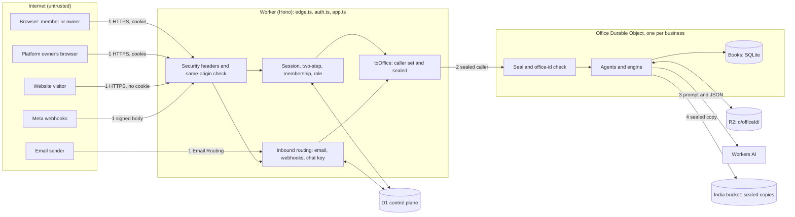

# Threat model

What Agentic Office protects, from whom, where the trust boundaries are, and for each main flow the threats (STRIDE)
and the control that answers each, with the code that carries it. Written 20 November 2026 against `main` at
`8abeccd`. Review it when a flow, a boundary or a control changes; `docs/security/asvs.md` checks the same controls
against ASVS 4.0.3.

This repository is public. Residual risks are named, never how to exploit them; the founders hold a private review
with that detail. The decisions behind the design are in `docs/adr/`.

STRIDE: **S**poofing, **T**ampering, **R**epudiation, **I**nformation disclosure, **D**enial of service, **E**levation
of privilege.

## 1. Assets

| Asset | Where it lives | Why it matters |
| --- | --- | --- |
| An office's books: ledger, bills, invoices, GST and TDS figures, payroll, customers, the edit log | The office's Durable Object (SQLite) | Confidential business and personal data; legal records under the Companies (Accounts) Rules |
| An office's documents and media | R2 under `o/<officeId>/` | Bills, statements, payslips, photos; often personal data |
| Sealed copies of the books | India bucket (daily), R2 `retained/` (eight years after a purge) | The same data, outside the office |
| Accounts, sessions, two-factor secrets, memberships, invitations | D1 control plane | Whoever holds these acts as the person |
| Platform tokens (Meta, LinkedIn, X), WhatsApp links | The office (sealed per office), D1 (links) | Post or message as the business |
| Root secrets: `BETTER_AUTH_SECRET`, `SOCIAL_TOKEN_KEY`, API keys | Worker secrets, Infisical | Every derived key and seal depends on them |
| Customers' conversations | The office (`cs_thread`, `cs_message`) | Personal data of the business's customers |
| The office audit trail and the team log | D1 `audit`, the office | Who did what; evidence |

## 2. Actors

| Actor | Trust | Reaches the system through |
| --- | --- | --- |
| A member of another office | Signed in, but none of this office's data | The app and API, with their own session |
| Owner | Full control of their office; two-step sign-in required | The app, WhatsApp (linked phone), email (proven sender) |
| Accountant | Works the books; may decide only some staged kinds | The app, WhatsApp, email |
| Platform owner | Runs the platform; addresses in `PLATFORM_OWNERS`; two-step sign-in | The console (`/api/platform/*`), the admin tool, the Cloudflare account |
| Email sender | Anyone on the internet; trusted only when Cloudflare proves the sender | Email Routing to the Worker's `email` handler |
| Website visitor | Anonymous; on a business's own site | The chat widget, `/w/*` and `/api/chat/*` |
| Meta (webhooks) | Trusted only with a valid signature | `/api/hooks/meta` |
| The model | Untrusted output; may be steered by text in what it reads | Workers AI, called by the office |
| Anyone on the internet | None | Every public route |

## 3. Trust boundaries

1. **Internet to Worker.** Everything from outside is untrusted until the Worker has checked it: a session and
   membership for people, a signature for Meta, Cloudflare's own verdict for email, a key and limits for the chat.
2. **Worker to Office.** The office believes only a caller the Worker sealed for its own id (ADR 0006).
3. **Office to model.** Model output is untrusted data, parsed into a fixed shape and checked by the engine (ADR 0004).
4. **Office to outside stores.** Copies leave only sealed (ADR 0007).

Between offices there is no shared store of books (ADR 0001); the control plane holds who belongs where (ADR 0002).

## 4. Flows

Each table names the threat and the control. Code paths are under `apps/api/src/` unless they say otherwise; tests
under `apps/api/test/`.

### 4.1 Sign-in

| | Threat | Control |
| --- | --- | --- |
| S | Password guessing or stuffing | Rate limits in D1 per `cf-connecting-ip`, which a client cannot set (`auth.ts`, `rateLimit`); 10-character minimum; two-step sign-in for owners and platform owners (`step-up.ts`). Tests: `auth.test.ts` "the sign-in rate limit", "two-factor sign-in" |
| S | A stolen session used for the riskiest actions | Export, invitations, role changes, hand-over, deletion and every console change need a sign-in or step-up in the last 15 minutes (`freshOnly`, `platformOnly` in `app.ts`; `isFresh` in `step-up.ts`). Test: `tenancy.test.ts` "a fresh sign-in for the riskier owner actions" |
| S | Login CSRF from another site | Every non-GET `/api/*` must carry the app's own Origin, `/api/auth/*` included (`sameOrigin` in `edge.ts`). Test: `edge.test.ts` "changes come only from the app's own pages" |
| I | Learning who has an account | Sign-up answers the same for new and existing addresses; the address's owner is told (`auth.ts`, `onExistingUserSignUp`). Password reset says nothing either way. Test: `auth.test.ts` "making an account" |
| I | Password hashes read from D1 | PBKDF2-SHA256, 16-byte random salt, 100,000 iterations chained in rounds (`auth.ts`). Test: `auth.test.ts` "password hashes" |
| T | Session fixation or theft in the browser | better-auth issues a new session on sign-in; cookies are Secure, HttpOnly, SameSite; no cookie cache; sessions end after 12 idle hours (`auth.ts`, `session`) |
| R | Denying a sign-in or a sensitive change | Sessions are rows in D1; office changes go to the audit trail (`ControlPlane.audit` in `tenancy.ts`) |
| E | An owner without two-step reaching owner routes | Owner routes and the console answer 403 `two_factor_required` until enrolled (`app.ts`, `twoFactorMissing`). Test: `tenancy.test.ts` "two-factor sign-in for owners" |

### 4.2 A request to an office

| | Threat | Control |
| --- | --- | --- |
| S | A member of office A asks for office B | Membership checked in D1 on every request, never cached; anything else is the same 404 as a missing office (`app.ts`, the `/api/o/:office/*` middleware). Test: `tenancy.test.ts` "one office cannot reach another" |
| S | A forged caller reaches the Durable Object | The caller is set by `toOffice` and sealed with an HMAC; the office refuses an unsealed caller, a caller for another office, and anyone but the system on `/internal/*` (`caller-seal.ts`; `callerOf`, `onRequest` in `office-agent.ts`). Test: `test/do/internal.test.ts` "the office's own routes" |
| T | A cross-site page drives a change | Same-origin check and accepted body types on every non-GET (`edge.ts`) |
| T | A half-applied change saved later | A failed request reopens the books as last saved (`office-agent.ts`, `reopen`). Test: `test/do/rollback.test.ts` |
| T | A file key built from a client path | R2 keys are built by the server from the checked office id (`keys.ts`); file ids are random UUIDs (`newDocId` in `caller.ts`). Test: `edge.test.ts` "document ids" |
| R | Denying a change to the books | Every saved change goes to the office's hash-chained edit log (`packages/engine/src/bookslog.ts`) with the person's name. Test: `compliance.test.ts` "the edit log in the office's SQLite" |
| I | A stored file runs as a page in the app's origin | Files are served inline only as PDF or PNG, JPEG, WebP, under `Content-Security-Policy: sandbox`; anything else downloads as bytes (`fileHeaders` in `edge.ts`). Test: `edge.test.ts` "stored files" |
| I | Script injection in the app | React escaping; a strict CSP with one hashed inline script; `frame-ancestors 'none'` (`edge.ts`, `apps/web/public/_headers`). Test: `edge.test.ts` "security headers" |
| D | One office exhausting AI or storage | Per office per day: 400 AI calls (150 for customer service), 250 MB of uploads (`quota.ts`). Test: `tenancy.test.ts` "quotas" |
| E | An accountant approves what only the owner may | Role checks in the engine's dispatcher (`packages/engine/src/dispatch.ts`, `ACCOUNTANT_CAN_DECIDE`); owner-only routes in `app.ts` (`ownerOnly`). Tests: `tenancy.test.ts` "people in an office" (administration), `packages/engine/test/whatsapp.test.ts` (decisions an accountant may not make) |
| E | A removed member keeps watching | The live WebSocket closes when a member is removed or the office is suspended or deleted (`closeLive` in `app.ts`). Tests: `test/do/live.test.ts`, `tenancy.test.ts` "open screens of someone who leaves" |

### 4.3 Inbound email

| | Threat | Control |
| --- | --- | --- |
| S | A sender poses as an owner, member or known party | A sender is believed only when Cloudflare's own `Authentication-Results` shows DMARC, or a DKIM signature aligned with the `From:` domain, passed (`mailVerdict` in `mail.ts`, `provenSender` in `inbound.ts`). Unproven mail still arrives but waits for the owner. Test: `inbound.test.ts` "who sent a message" |
| S | Mail for an address no office owns | The `route` table maps the address to one office; unknown addresses are rejected at SMTP (`receiveEmail` in `app.ts`) |
| T | A file stored under a type the sender chose | The type comes from the file's name and bytes, never the declared type (`filetype.ts`). Test: `filetype.test.ts` |
| T | Header injection in replies | Outgoing headers are kept to one line (`oneLine` in `mail.ts`). Test: `worker.test.ts` "mail" |
| T | Text in a bill steers the model | The model answers in a fixed JSON shape; the engine recomputes and checks every amount; the result is staged for approval (`reading.ts`, ADR 0004) |
| I | Mail for one office stored in another | The office admits the mail itself before anything is stored (`/internal/mail-admit`, `admitMail` in `office-agent.ts`) |
| D | Mail floods or oversized attachments | Hourly limits per sender, domain and in total, a separate pool for unproven mail, at most 5 attachments of 10 MB, the upload allowance, all checked before R2 (`MAIL_LIMITS` in `inbound.ts`, `mail.ts`). Test: `inbound.test.ts` "what the office takes in before anything is stored" |
| E | Mail from a member acts as an owner's instruction | Only a proven owner's mail is taken as theirs (`ownerOf`, `forwardedByHand` in `inbound.ts`); what it proposes is staged |

### 4.4 WhatsApp

| | Threat | Control |
| --- | --- | --- |
| S | A forged webhook delivery | The raw body's `x-hub-signature-256` is checked against the app secrets before parsing; bodies over 1 MB are refused (`verifyMetaSignature` in `social/webhooks.ts`, `/api/hooks/meta` in `app.ts`). The verify token is compared in constant time. Test: `social.test.ts` "Meta webhooks" |
| S | Someone links their phone to another person's account | JOIN codes are 8 characters from an unambiguous alphabet, valid 15 minutes, with a limit per number and across all numbers (`whatsapp/links.ts`). Each link is audited and shown in Settings. Test: `whatsapp.test.ts` "linking a number" |
| I | A delivery for one office reaches another | Each entry is routed by its page, account or linked phone; a delivery can be split across offices, each getting only its part (`planMeta` in `routing.ts`, `deliverMeta` in `app.ts`). Test: `tenancy.test.ts` "the shared WhatsApp number" |
| I | Platform tokens read from storage | Tokens are sealed with AES-GCM under an HKDF key per office and channel (`social/tokens.ts`). Test: `social.test.ts` "tokens at rest" |
| T | A channel sign-in (OAuth) replayed or redirected | Signed, expiring `state` naming the office and owner, good once; PKCE (`social/oauth.ts`). Tests: `social.test.ts` "sign-in state", `test/do/signin.test.ts` |
| D | Message floods | Linked people only; documents capped at 10 MB (`whatsapp/office.ts`); the office's AI allowance |
| E | A customer messages the shared number to reach the books | The shared number serves linked members only and is never used to talk to customers; customers reach an office only on its own number, through the Customer Service agent |

### 4.5 Website chat

| | Threat | Control |
| --- | --- | --- |
| S | Bots posing as visitors | Turnstile required on live; without its secret the chat answers 503 (`/api/chat/:key` in `app.ts`, `turnstileOk` in `customer/channels.ts`). Test: `customer.test.ts` "the website chat's person check" |
| I | A visitor reads someone else's orders or balance | Orders and balances only after a one-time code sent to the email or WhatsApp on the order (`packages/engine/src/customer/desk.ts`). Test: `customer.test.ts` "the website chat's one-time code" |
| I | The chat reveals whether a business uses it | A disabled or unknown key answers like none (`WIDGET_KEY`, `routeFor` in `app.ts`) |
| T | Model-written text reaches a customer | The agent answers only from the books, a fact or a saved answer; the model chooses among them in a fixed shape (`CS_SCHEMA` in `customer/desk.ts`) |
| D | Flooding an office with conversations or polls | Rate limits per widget, visitor and address, polling included; at most 300 new conversations an office a day; message length capped (`chatLimited` in `app.ts`). Test: `tenancy.test.ts` "the website chat" |
| E | The chat's open CORS used against the app | CORS `*` only on `/api/chat/*`, which carries no cookies or credentials; every other non-GET needs the app's Origin (`edge.ts`) |

### 4.6 Export

| | Threat | Control |
| --- | --- | --- |
| S | A stolen session takes the whole office | Owner only, two-step sign-in, and a sign-in or step-up in the last 15 minutes (`ownerOnly`, `freshOnly` in `app.ts`) |
| I | The archive includes another office's files | The office lists only its own `o/<officeId>/` keys and writes the archive itself (`OfficeExports` in `export.ts`). Test: `test/do/export.test.ts` |
| R | Denying an export | `office.exported` is written to the audit trail before the download starts (`app.ts`) |
| D | An export exhausting the Worker | Written by the Durable Object in parts of 250 files, at most 200 MB, streamed without buffering (`export.ts`, `zip.ts`, ADR 0005). Test: `zip.test.ts` |

### 4.7 Backup (daily copy in India)

| | Threat | Control |
| --- | --- | --- |
| I | The bucket or its key leaks | Each copy is sealed with a fresh AES-256-GCM data key wrapped by the office's own key; no key, no copy (`envelope.ts`, `backupToIndia` in `office-agent.ts`, ADR 0007). Test: `compliance.test.ts` "the daily copy in India" |
| T | A copy altered in the bucket | AES-GCM authenticates the copy and its header; opening fails on any change (`envelope.ts`, `open`) |
| S | Uploading as someone else | Requests are signed with AWS Signature Version 4 under a key for that bucket only (`backup.ts`) |
| D | A failed copy goes unnoticed | The failure is stored and shown in Settings, and tried again the next day (`backupStatus` in `office-agent.ts`) |

### 4.8 Purge and deletion

| | Threat | Control |
| --- | --- | --- |
| E | Purging an office by asking its Durable Object | `/internal/purge` answers only the system caller (ADR 0006); the nightly cron is the only caller (`purgeDeleted` in `app.ts`) |
| T | A mistaken deletion destroys the books | Deleting hides the office for 30 days; the owner can restore or export meanwhile; the purge first seals a retained copy (`purge` in `office-agent.ts`). Without `SOCIAL_TOKEN_KEY` the purge is refused. Test: `test/do/purge.test.ts` |
| I | Copies outlive their purpose | The purge queues the office's India copies for deletion and retries each night; retained copies are deleted once their eight years are over (`eraseBackups`, `sweepRetained` in `app.ts`). Test: `tenancy.test.ts` "suspending, deleting and purging" |
| R | Denying a deletion | Each step is in the office's audit trail; a deleted account leaves a done request with no name or address (`account.ts`). Test: `tenancy.test.ts` "a person's own rights" |
| D | A purge stuck halfway | `/internal/purge` is idempotent; each nightly step runs on its own (`nightly` in `app.ts`) |

### 4.9 Platform console

| | Threat | Control |
| --- | --- | --- |
| S | Someone reaching the console | Only addresses in `PLATFORM_OWNERS`, with a confirmed address and two-step sign-in; every change needs a fresh sign-in (`platformOnly` in `app.ts`). Test: `tenancy.test.ts` "the platform owners' console" |
| E | A platform owner taking over a business | The console may invite an owner only into an office that has none and never sees the link; once an office has an owner, outside owner invitations stop working (`tenancy.ts`, `acceptInvite`) |
| I | The console reading books | The console and the admin tool work on the control plane only; neither has a command to read an office's books (`tools/admin/admin.mjs`) |
| I | Invitation tokens in logs | Tokens travel after `#` and in request bodies; only their hash is stored; single use, bound to one address, 14 days (`tenancy.ts`, `inviteLink` in `app.ts`) |
| R | Denying a console action | Onboarding, suspension and owner invitations are audited, for example `platform.owner_invited` |

## 5. Residual risks

Accepted or open, in no particular order. The open work and its order are in `docs/security/README.md`.

| Risk | Why it remains | Mitigation now |
| --- | --- | --- |
| Password hashes below OWASP's current iteration figure | Free plan CPU (ADR 0005) | Two-step sign-in for owners and platform owners, rate limits, the parked move to 600,000 |
| Inbound sender proof depends on Cloudflare stamping every message | Not yet confirmed on live mail | Unproven mail waits for the owner; confirming it is open work |
| Live secrets kept in the shared development secrets environment | The restricted production environment is an owner step | Secrets never in files or logs; rotation planned with the move |
| Live files in R2 encrypted only by the storage provider's key | Office-key encryption of live files is in progress | Files reachable only through the office's checked path or a signed, expiring link |
| What an old root key sealed stays readable with it after a rotation | Re-sealing copies under the new key is not automated | Keys derived per office and purpose; each sealed thing names its root key, so a rotation (handbook 05, section 3a) moves everything new to the new key and platform tokens on their next read |
| People with deploy rights or the Cloudflare account could change code that reads books | Inherent to running the service | CI gates on every pull request; live releases behind a reviewer once the GitHub environments are set; branch protection is an owner step |
| A model steered by text in a document, email or chat | Models can be steered | Fixed output shapes, engine checks, staged approval; trust levels are the owner's choice |
| Text layers come from the uploader's browser | CPU budget (ADR 0003) | The engine recomputes totals; the approver sees the highlighted source |
| No error-rate alerts yet | Alerts are an owner step in the Cloudflare dashboard (handbook 04, section 9) | Structured logs with request and office ids (`apps/api/src/log.ts`); Workers Issues; the audit trail and edit log |
| No antivirus scan of stored files | Not available within the free plan | Files never run in the app's origin; other types download as bytes |
| Limits that protect against guessing can also be tripped to slow legitimate use | A trade of availability for safety | Limits are per number and per hour; trips are logged |
| No external penetration test yet | Planned before the first enterprise customer | Internal review of 19 November 2026 and the fixes since |
